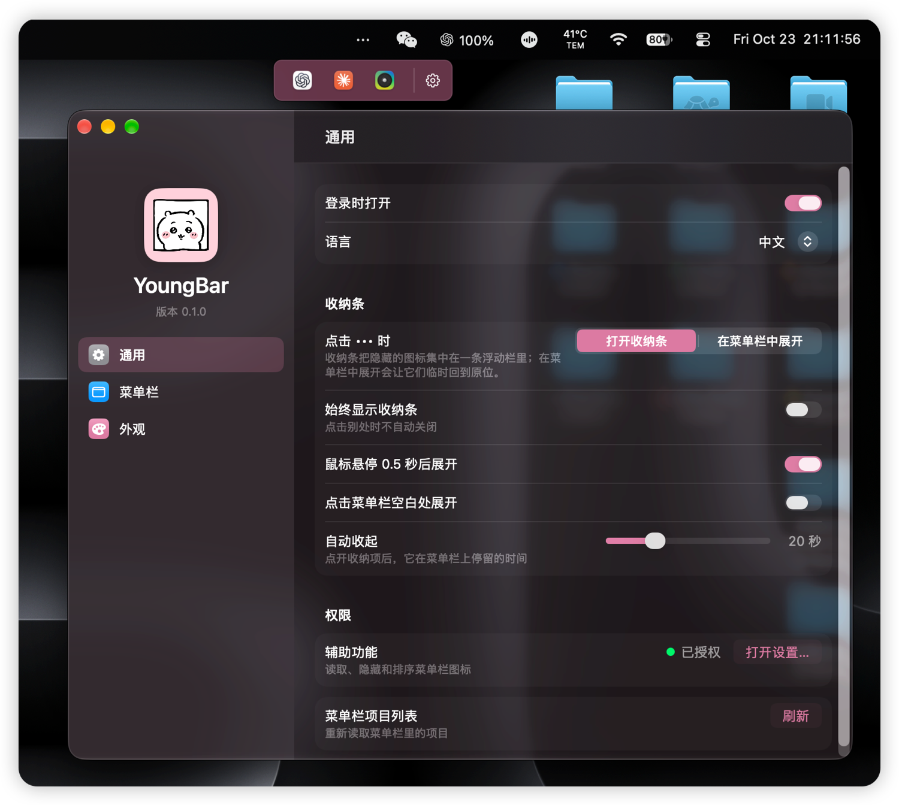
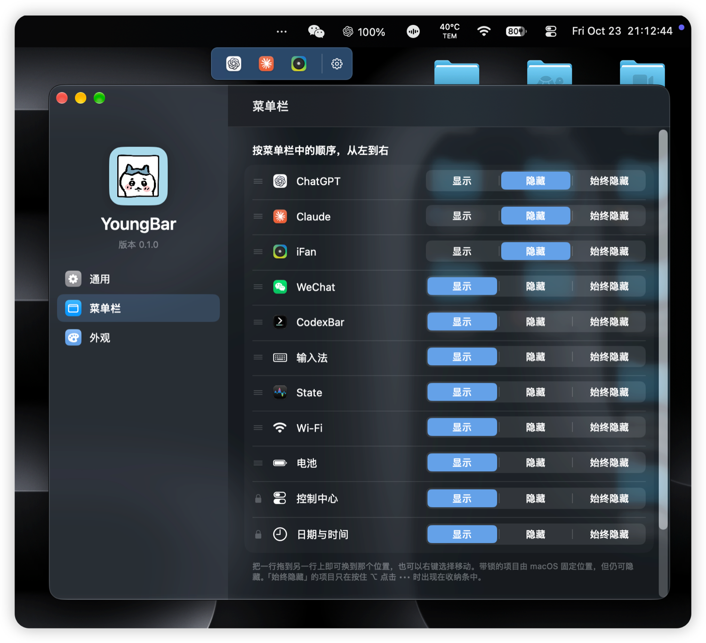
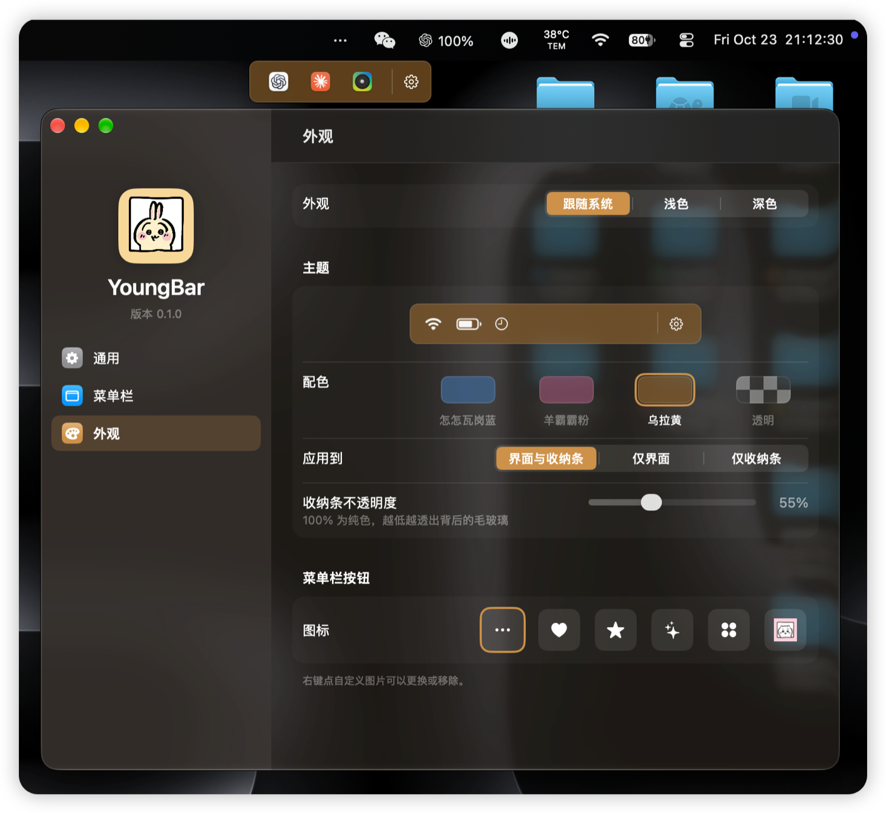
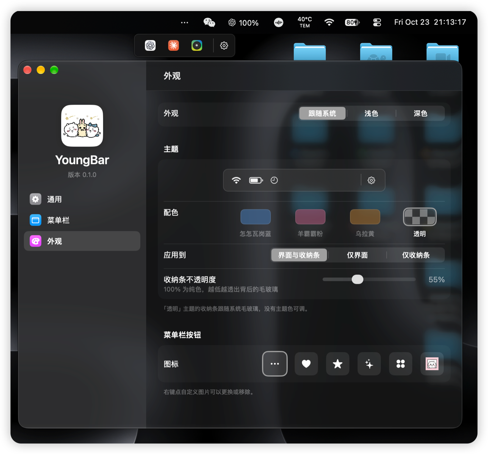

**Disclaimer: This is an unofficial project; character artwork remains the property of its rights holders.**

# YoungBar · 羊霸霸

[中文](README.md) | **English**

A keyboard-first menu bar organizer for **macOS 27 and later only** (Apple silicon Macs). Hide the icons you do not need, open them from one compact strip, and click through to their native menus — without the menu bar flashing or reflowing.



<p align="center">
  
  
  
</p>

## Install

**Requirements**: macOS 27 or later on an Apple silicon Mac (macOS 27 doesn't run on Intel Macs). macOS 26 and earlier (12, 13, 14, 15 and so on) are not supported: the app won't open there, and the install command stops with a message before changing anything. See [How it works](#how-it-works-and-the-trade-offs) for why.

1. Download the latest `YoungBar-<version>.zip` from [Releases](../../releases/latest).
2. Unzip it and move `YoungBar.app` into `/Applications`.
3. First launch: right-click the app → **Open**.
4. A short guide asks for Accessibility on first launch. Enable *Open at login* in Settings if you want it at login.

YoungBar lives in the menu bar (•••); it has no Dock icon.

**Updating**: YoungBar checks once a day (from 0.1.4); a newer version adds a line at the top of the ••• right-click menu, which shows the notes with *Install and Relaunch*, which downloads, verifies and swaps it in place. *Check for Updates…* works any time. Running the install command again, or downloading the zip, works too.

### Install with an agent

Send this to ChatGPT, Doubao, Claude, DeepSeek (DSH), or any other agent:

> Install YoungBar for me: run `curl -fsSL https://raw.githubusercontent.com/51younglowkey/youngbar/main/Scripts/install.sh | sh`

Or run the command directly (it installs to `/Applications`, or `~/Applications` if that isn't writable):

```sh
curl -fsSL https://raw.githubusercontent.com/51younglowkey/youngbar/main/Scripts/install.sh | sh
```

## Features

- **Three states per item**: Visible, Hidden, Always Hidden (⌥-click to include Always Hidden in the strip).
- **Instant strip**: each hidden item is shown by its app's own icon (system items by their SF Symbol); opening the strip never reveals anything. An empty strip lists the icons on your bar: click one to tuck it in.
- **Open in place**: clicking a third-party item in the strip presses it through Accessibility while it stays hidden, so its menu or panel opens beside the strip without the bar shifting or the pointer moving. System items are revealed and clicked with the pointer hidden.
- **Reorder**: ⌘-drag in the real menu bar and drag a row in the Menu Bar page; right-click a row for left/right moves. Icons in the strip can be dragged sideways too, without the bar flickering.
- **Keyboard first**: press ⌘ twice to open the strip (change it in General to a key combination, or ⌥ / ⌃ pressed twice). The icons are numbered 1–9: press a number to open one, or ← → and Return; Esc closes.
- **New icons to the strip** (optional): an app's icon that appears in the bar for the first time goes straight to the strip; system icons are left alone.
- **Icons that don't fit**: when the bar is full, macOS 27 moves icons into a « beside the notch. YoungBar lists those in the strip too and tags them "No room" on the Menu Bar page; they leave the strip by themselves once there is room. The ••• control stays visible instead of following them under the notch.
- **Menu Bar page**: every item in menu-bar order with Shown / Hidden / Always Hidden segmented choices; Date and Control Center keep their macOS-fixed position but can be hidden.
- **Settings window**: System Settings-style sidebar and grouped forms (SwiftUI inside an AppKit window); the menu-bar logic stays in AppKit.
- **Appearance**: system / light / dark; blue, pink and yellow palettes with matched OKLCH lightness/saturation, plus a neutral clear one; a theme-tinted glass window with the theme character in the sidebar; one strip opacity slider (30–100%).
- **Custom menu-bar button**: ellipsis, heart, star, sparkles, grid, or a 36×36 PNG.
- **Settings entry from the strip**: a pinned gear at the right edge; right-click an icon in the strip to put it back in the bar or make it Always Hidden.
- **What's New and diagnostics**: the first launch after an update shows what changed; *Copy Diagnostics* in the ••• menu gives a short report to paste when something looks wrong.
- **Few settings**: General has open at login, language, the shortcut and three strip switches; everything else is a fixed default.
- **Layout file**: export every icon's state, the order and all options to one JSON file, and import it on another Mac.
- **First-run guide**: one permission, then where things are.
- **In-app updates**: asks GitHub once a day; a newer version adds a line at the top of the ••• right-click menu that downloads it, checks the SHA-256 and the signing certificate (it must be the same as this app's) and relaunches. Nothing installs by itself.
- **Crash-safe**: a normal quit reveals every concealed item first; after a crash the next launch reveals everything before re-applying rules. `--reveal-all` is a rescue flag.
- **Bilingual**: Chinese and English, switchable in General.
- **Local only**: no telemetry, no screen capture; the only network use is the daily update check. About 0.3% CPU at rest.

See [docs/FAQ.md](docs/FAQ.md) for the IP/licence/private-API/distribution questions.

## Build from source

Building from source needs macOS 27 and the Command Line Tools (Swift 6.4); Xcode is not required.

```sh
sh Scripts/build.sh
open build/YoungBar.app
swift test --disable-sandbox   # unit tests
```

`TESTHOOKS=1 sh Scripts/build.sh` builds a variant with the live self-tests (they drive the real menu bar; see `AGENTS.md`). Release packages never include them.

`Scripts/build.sh` builds a release executable, assembles `build/YoungBar.app`, installs the icon, and signs with a stable local certificate if one is configured (otherwise ad-hoc). See [docs/SIGNING.md](docs/SIGNING.md), [docs/INSTALL.md](docs/INSTALL.md) and [docs/RELEASING.md](docs/RELEASING.md).

To produce a release zip and SHA256:

```sh
make package
```

## Permissions

| Permission | Why | Without it |
|---|---|---|
| **Device Control and Data Access** (Accessibility on macOS 27) | enumerate, hide, reveal and reorder menu-bar items | the strip is empty; only settings work |

YoungBar does **not** capture the screen and does **not** need Screen & System Audio Recording. If macOS stops recognizing the app after a rebuild, remove the old YoungBar entry and grant Accessibility again. A notarized Developer ID build removes that friction.

## How it works (and the trade-offs)

- **macOS 27 and later only**: hiding and ordering both rest on macOS 27's menu bar (the assessment interface below, and the item positions macOS 27's `MenuBarAgent` keeps); the engine was written and verified for macOS 27 only. Earlier versions would need a different way to hide and order icons — it isn't a matter of changing a version number.
- Hiding uses the private `MenuBarClientCore` assessment interface. It works on macOS 27 but is not a public API and may break on future releases. This app cannot be shipped on the App Store.
- The strip shows app icons, not the items' live menu-bar content: a concealed item is not drawn by macOS 27, so there is nothing current to show. Items whose value you watch belong in the visible part of the bar.
- There is no menu-bar screenshot capture or cache.

## Status and gaps

The current verification matrix is in [docs/STATUS.md](docs/STATUS.md); the iBar Pro 1.4.6 comparison is in [docs/IBAR-FEATURES.md](docs/IBAR-FEATURES.md).

Known gaps: multi-display is handled in code but untested (no second display available), dragging inside the strip has only been tested with three icons and no scrolling, and a real-trackpad pass on the SwiftUI settings. Launch-at-login has been registered but still needs a true logout/login test.

## Roadmap

- Multi-display verification.
- Profiles and per-app or per-situation rules (on battery, external display).

## License and credits

YoungBar is licensed under **GPL-3.0-only**. The full text is in [LICENSE](LICENSE); third-party components and asset provenance are in [THIRD_PARTY_NOTICES.md](THIRD_PARTY_NOTICES.md). Distribution rules, the corresponding-source checklist, and the MIT question are covered in [docs/LICENSING.md](docs/LICENSING.md); release steps are in [docs/RELEASING.md](docs/RELEASING.md).

`Vendor/PelmetCore` and `Vendor/PelmetEngine` come from the [Dimble source repository](https://github.com/fif7y/dimble), commit `23a5412` (0.3.2, build 71), originally named Pelmet, under GPLv3. The vendored manifests drop the upstream probe executable and tests; implementation files are retained. A copy of the license sits in `Vendor/LICENSE`.

YoungBar's own UI and app code are original. The interaction model is informed by iBar Pro 1.4.6; no iBar assets, icons, or code are included. Theme artwork is user-supplied and is **not yet cleared for public distribution**; see [docs/FAQ.md](docs/FAQ.md).

## Contact

Rights-holder and removal requests: **wuyiyang.studio@gmail.com**
