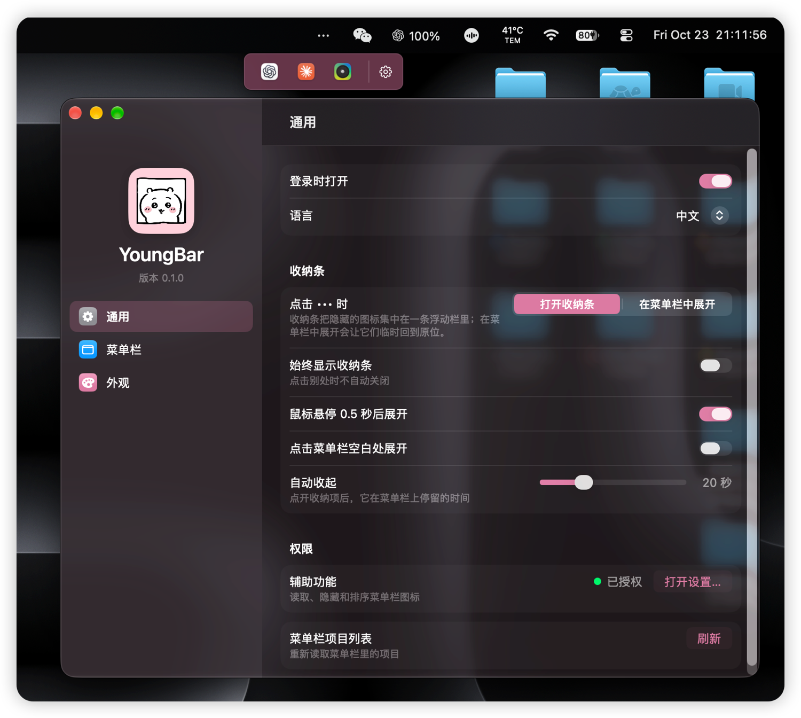
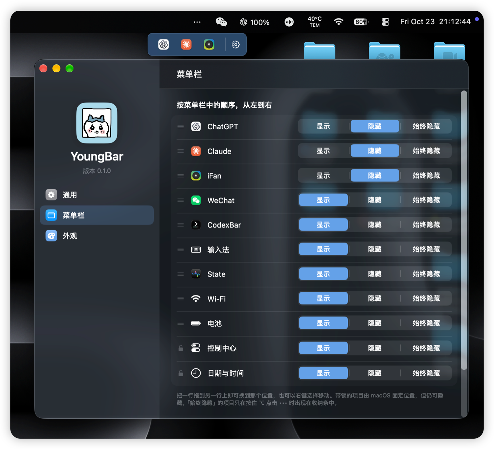
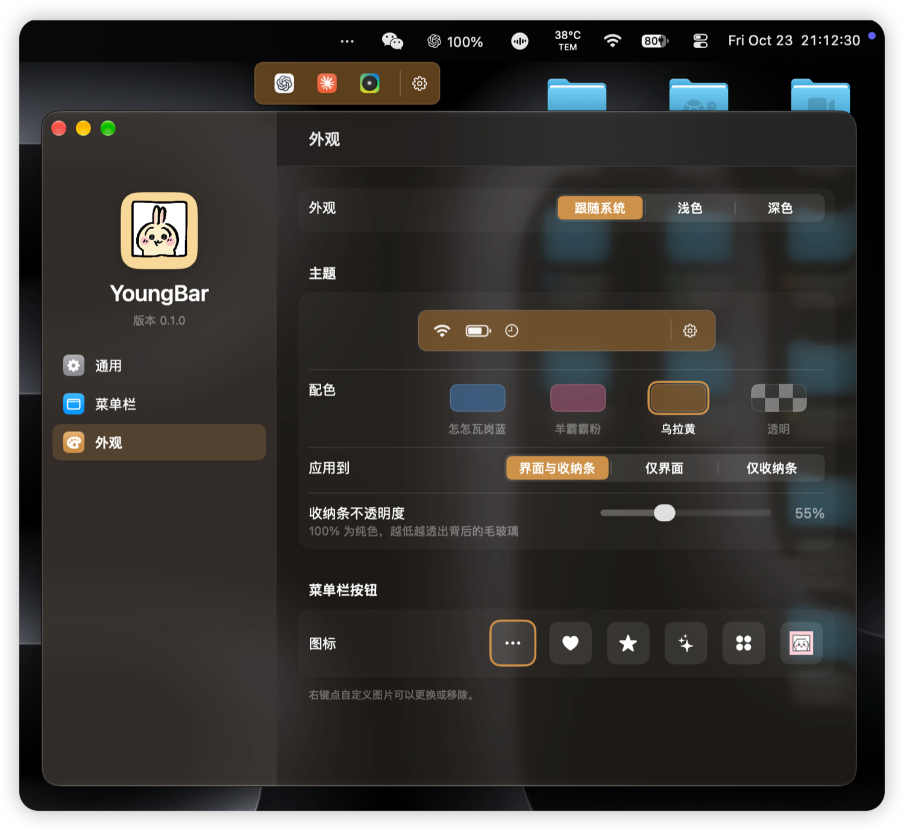
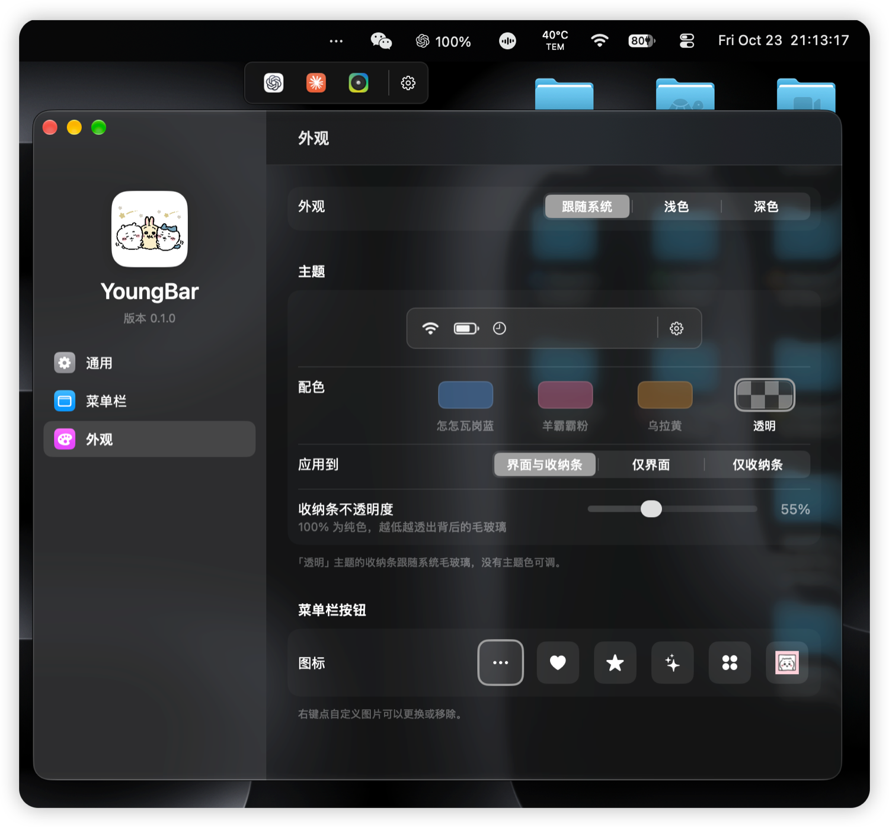

**声明：本项目非官方授权，角色素材版权归原权利人所有。**

# YoungBar · 羊霸霸

**中文** | [English](README.en.md)

一个为 **macOS 27** 设计的键盘优先菜单栏收纳工具。把不常用的图标收起来，从一条紧凑的收纳条里打开；点一下就能进入应用原生的菜单或面板，菜单栏不会闪烁或重排。



<p align="center">
  
  
  
</p>

## 安装

1. 从 [Releases](../../releases) 下载 `YoungBar-0.1.0.zip`。
2. 解压，把 `YoungBar.app` 放进 `/Applications`。
3. 第一次打开：右键 app → **打开**。
4. 按提示允许辅助功能；需要开机启动就在设置里打开「登录时打开」。

安装后入口在菜单栏 •••，没有 Dock 图标。

### 用 Agent 安装

把下面这句话发给 ChatGPT、豆包、Claude、DeepSeek（DSH）等任意 Agent：

> 帮我安装 YoungBar：运行 `curl -fsSL https://raw.githubusercontent.com/51younglowkey/youngbar/main/Scripts/install.sh | sh`

也可以直接复制命令：

```sh
curl -fsSL https://raw.githubusercontent.com/51younglowkey/youngbar/main/Scripts/install.sh | sh
```

## 功能

- **每个项目三种状态**：显示 / 隐藏 / 始终隐藏（⌥ 点击 ••• 可把「始终隐藏」也放进收纳条）。
- **即时收纳条**：每个隐藏项显示应用自己的图标（系统项用 SF Symbol）；打开收纳条不会临时显示任何图标。
- **原地打开**：点收纳条里的第三方项时，在隐藏状态下直接 AXPress，不显示图标、不动鼠标，菜单或面板就在收纳条旁打开。系统项没有 AXPress，才短暂显示后点击，点击时隐藏光标。
- **排序**：在真实菜单栏里 ⌘ 拖动，或在「菜单栏」页拖动整行；右键可以左移/右移。
- **全局快捷键**：⌃⌥B 打开/收起收纳条。
- **菜单栏页**：按菜单栏顺序列出每一项，用「显示 / 隐藏 / 始终隐藏」分段按钮选择；日期与控制中心由 macOS 固定位置，但仍可隐藏。
- **设置窗口**：System Settings 风格的侧栏 + 分组表单（SwiftUI 内容，AppKit 外壳）；菜单栏逻辑仍在 AppKit。
- **外观**：跟随系统 / 浅色 / 深色；蓝 / 粉 / 黄使用 OKLCH 同亮度同彩度，另有中性透明；主题色玻璃窗口、侧栏角色图、三档应用范围和 30–100% 收纳条不透明度。
- **自定义菜单栏按钮**：省略号、爱心、星形、闪光、网格，或你自己的 36×36 PNG。
- **收纳条设置入口**：右侧固定齿轮。
- **崩溃恢复**：正常退出前先显示所有隐藏项；异常退出后，下次启动会先全部显示再套用规则。`--reveal-all` 是救援参数。
- **中英双语**：在「通用」里切换。
- **纯本地**：没有遥测、没有网络、不截屏。

关于 IP、许可证、私有 API 和分发，见 [docs/FAQ.md](docs/FAQ.md)。

## 从源码构建

需要 macOS 27 和 Swift 6.3 工具链。

```sh
sh Scripts/build.sh
open build/YoungBar.app
```

`Scripts/build.sh` 会编译 release、组装 `build/YoungBar.app`、装图标，并在配置了本地证书时用证书签名（否则 ad-hoc）。详见 [docs/SIGNING.md](docs/SIGNING.md)、[docs/INSTALL.md](docs/INSTALL.md) 和 [docs/RELEASING.md](docs/RELEASING.md)。

打发布包：

```sh
make package
```

## 权限

| 权限 | 用途 | 没有时 |
|---|---|---|
| **设备控制与数据访问**（macOS 27 的辅助功能） | 枚举、隐藏、展开、排序菜单栏项目 | 收纳条为空，只能打开设置 |

YoungBar **不截屏**，**不需要屏幕录制**。如果重建后 macOS 不再信任这个 app，删掉旧的 YoungBar 条目，重新打开辅助功能即可。使用 Developer ID 公证的构建可以消除这个摩擦。

## 工作原理与取舍

- 隐藏使用私有 `MenuBarClientCore` 评估接口。它在 macOS 27 上可用，但不是公开 API，未来系统更新可能失效；因此不能上架 Mac App Store。
- 收纳条显示应用图标，而不是隐藏项当前的菜单栏内容：项目隐藏后 macOS 27 不再绘制它，没有实时内容可显示。需要一直看的数值应该留在菜单栏常显区。
- 不抓取、不缓存菜单栏截图。

## 状态与缺口

当前验证矩阵在 [docs/STATUS.md](docs/STATUS.md)；iBar Pro 1.4.6 的对照在 [docs/IBAR-FEATURES.md](docs/IBAR-FEATURES.md)。

已知缺口：多显示器、可配置快捷键、键盘导航、收纳条内拖拽排序，以及 SwiftUI 设置的真实触控板手感。登录项已注册，但还需要真正登出/重启验证一次。

## 路线图

- 可配置快捷键、键盘导航（方向键 / Enter / Esc）、布局搜索。
- 配置导入导出、按应用规则。
- 多显示器。
- 公证发布、自动更新。

## 许可证与致谢

YoungBar 使用 **GPL-3.0-only**。完整文本见 [LICENSE](LICENSE)；第三方组件与素材来源见 [THIRD_PARTY_NOTICES.md](THIRD_PARTY_NOTICES.md)。分发规则、对应源码清单和「为什么不能改 MIT」见 [docs/LICENSING.md](docs/LICENSING.md)；发布步骤见 [docs/RELEASING.md](docs/RELEASING.md)。

`Vendor/PelmetCore` 与 `Vendor/PelmetEngine` 来自 [Dimble 源码仓库](https://github.com/fif7y/dimble) 的 `23a5412`（0.3.2，build 71，原 Pelmet），使用 GPLv3。vendored manifest 去掉了上游的 probe 可执行文件和测试，实现文件保留；许可证副本在 `Vendor/LICENSE`。

YoungBar 自己的 UI 与应用代码是原创的。交互模型参考了 iBar Pro 1.4.6；没有包含 iBar 的素材、图标或代码。主题角色素材由用户提供，**尚未确认公开分发授权**，见 [docs/FAQ.md](docs/FAQ.md)。

## 联系方式

权利人或相关方请联系：**wuyiyang.studio@gmail.com**
