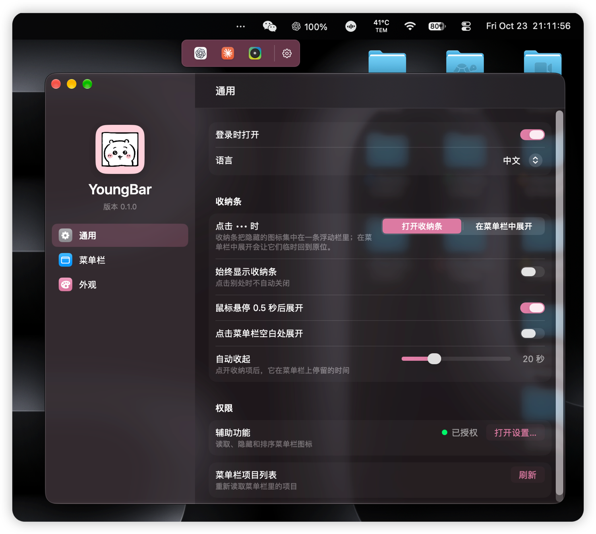
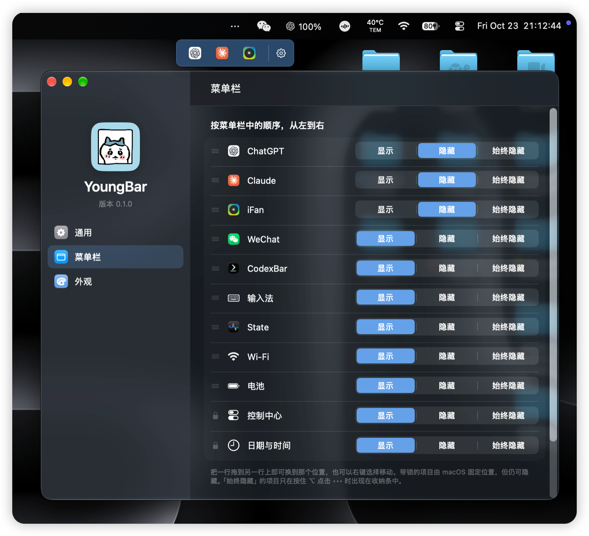
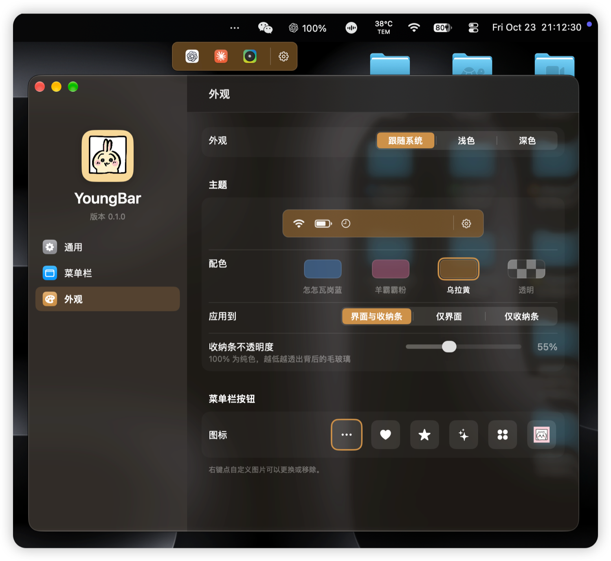
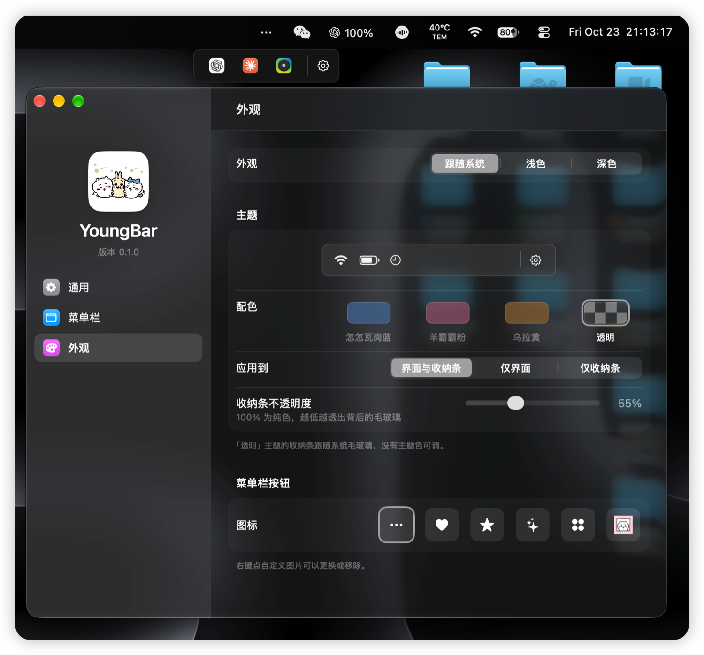

**声明：本项目非官方授权，角色素材版权归原权利人所有。**

# YoungBar · 羊霸霸

**中文** | [English](README.en.md)

一个键盘优先的菜单栏收纳工具，**只支持 macOS 27 及以上**（Apple 芯片的 Mac）。把不常用的图标收起来，从一条紧凑的收纳条里打开；点一下就能进入应用原生的菜单或面板，菜单栏不会闪烁或重排。



<p align="center">
  
  
  
</p>

## 安装

**系统要求**：macOS 27 或更新，Apple 芯片的 Mac。macOS 26 及更早的版本（12、13、14、15 等）都不支持：app 打不开，安装命令也会先提示再退出，不会改动任何东西。原因见[工作原理与取舍](#工作原理与取舍)。

1. 从 [Releases](../../releases/latest) 下载最新的 `YoungBar-<版本>.zip`。
2. 解压，把 `YoungBar.app` 放进 `/Applications`。
3. 第一次打开：右键 app → **打开**。
4. 按引导允许辅助功能；需要开机启动就在设置里打开「登录时打开」。

安装后入口在菜单栏 •••，没有 Dock 图标。

**升级**：YoungBar 每天自动检查一次，有新版本时右键 ••• 的菜单第一行会提示，点一下就能更新。下载后会核对校验值和签名，不会自己安装。

### 用 Agent 安装

把下面这句话发给能在你的 Mac 上运行命令的 Agent，比如 Claude Code、Codex 或 DeepSeek（DSH）。网页版 ChatGPT、豆包运行不了命令，用它们的话请直接复制后面的命令：

> 帮我安装 YoungBar：运行 `curl -fsSL https://raw.githubusercontent.com/51younglowkey/youngbar/main/Scripts/install.sh | sh`

也可以直接复制命令（装到 `/Applications`，没有写权限时装到 `~/Applications`）：

```sh
curl -fsSL https://raw.githubusercontent.com/51younglowkey/youngbar/main/Scripts/install.sh | sh
```

## 功能

- **三种状态**：每个图标可以设为显示、隐藏或始终隐藏（⌥ 点击 ••• 可把「始终隐藏」也放进收纳条）。
- **即时收纳条**：隐藏的图标都在收纳条里，打开时不会临时显示任何图标。收纳条空着时会列出菜单栏上的图标，点一下就收进来。
- **原地打开**：点收纳条里的图标，菜单或面板就在旁边打开，图标不用显示，鼠标也不动。系统图标会短暂显示后再点击。
- **排序**：在菜单栏里 ⌘ 拖动，或在设置的「菜单栏」页拖动；收纳条里的图标也能直接拖动换位置。
- **键盘优先**：连按两下 ⌘ 打开收纳条（可以改成别的快捷键），按 1–9 直接打开，也可以用 ← → 选择、回车打开，Esc 关闭。
- **新图标自动收纳**（可选）：第一次出现的应用图标直接放进收纳条，系统图标不受影响。
- **放不下的图标**：菜单栏满了时，被 macOS 收进 « 的图标也会列进收纳条，有空间时自动回到菜单栏。
- **外观**：跟随系统 / 浅色 / 深色，蓝、粉、黄和透明四套主题，收纳条不透明度可调；菜单栏按钮可以换图标，也可以用自己的图片。
- **配置文件**：把每个图标的状态、顺序和所有选项导出成一个 JSON，换机或重装时导入。
- **崩溃恢复**：正常退出前先显示所有隐藏项；异常退出后，下次启动会先全部显示再套用规则。`--reveal-all` 是救援参数。
- **中英双语**：在「通用」里切换。
- **占用低**：空闲时 CPU 约 0.3%。

遇到问题时，••• 菜单里的「复制诊断信息」可以直接粘贴给作者。关于 IP、许可证、私有 API 和分发，见 [docs/FAQ.md](docs/FAQ.md)。

## 从源码构建

需要 macOS 27 和命令行工具（Swift 6.4），**不需要 Xcode**。

```sh
sh Scripts/build.sh
open build/YoungBar.app
swift test --disable-sandbox   # 单元测试
```

签名和安装的细节见 [docs/SIGNING.md](docs/SIGNING.md) 和 [docs/INSTALL.md](docs/INSTALL.md)。

## 权限

只需要**设备控制与数据访问**（macOS 27 的辅助功能），用来读取、隐藏和排序菜单栏图标；没有它时收纳条是空的。YoungBar **不截屏**，**不需要屏幕录制**。

如果 macOS 不再信任这个 app，删掉旧的 YoungBar 条目，重新打开权限即可。

## 工作原理与取舍

- **只支持 macOS 27 及以上**：隐藏和排序都建立在 macOS 27 的菜单栏机制上，更早的系统需要另一套办法，不是改个版本号就能用。
- 隐藏图标和读取菜单栏颜色用的是私有接口（如 `MenuBarClientCore`），不是公开 API，未来系统更新可能失效；因此不能上架 Mac App Store。
- 收纳条显示应用图标，而不是隐藏项当前的菜单栏内容：项目隐藏后 macOS 27 不再绘制它，没有实时内容可显示。需要一直看的数值应该留在菜单栏常显区。

## 许可证与致谢

YoungBar 使用 **GPL-3.0-only**。完整文本见 [LICENSE](LICENSE)；第三方组件与素材来源见 [THIRD_PARTY_NOTICES.md](THIRD_PARTY_NOTICES.md)。分发规则、对应源码清单和「为什么不能改 MIT」见 [docs/LICENSING.md](docs/LICENSING.md)。

`Vendor/PelmetCore` 与 `Vendor/PelmetEngine` 来自 [Dimble 源码仓库](https://github.com/fif7y/dimble) 的 `23a5412`（0.3.2，build 71，原 Pelmet），使用 GPLv3。vendored manifest 去掉了上游的 probe 可执行文件和测试，实现文件保留；许可证副本在 `Vendor/LICENSE`。

YoungBar 自己的 UI 与应用代码是原创的。交互模型参考了 iBar Pro 1.4.6；没有包含 iBar 的素材、图标或代码。主题角色素材由用户提供，**尚未确认公开分发授权**，见 [docs/FAQ.md](docs/FAQ.md)。

## 联系方式

权利人或相关方请联系：**wuyiyang.studio@gmail.com**
