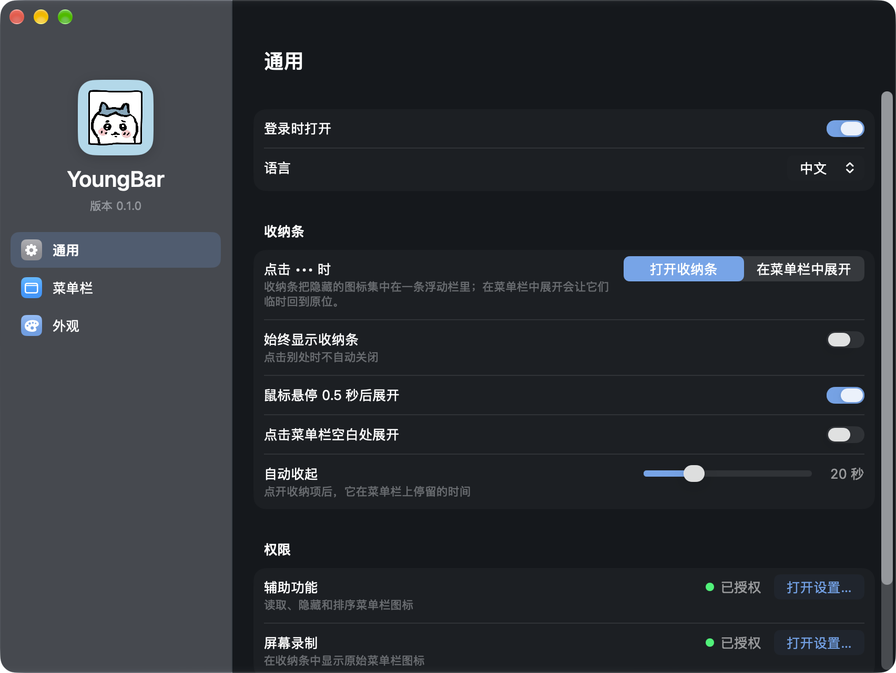
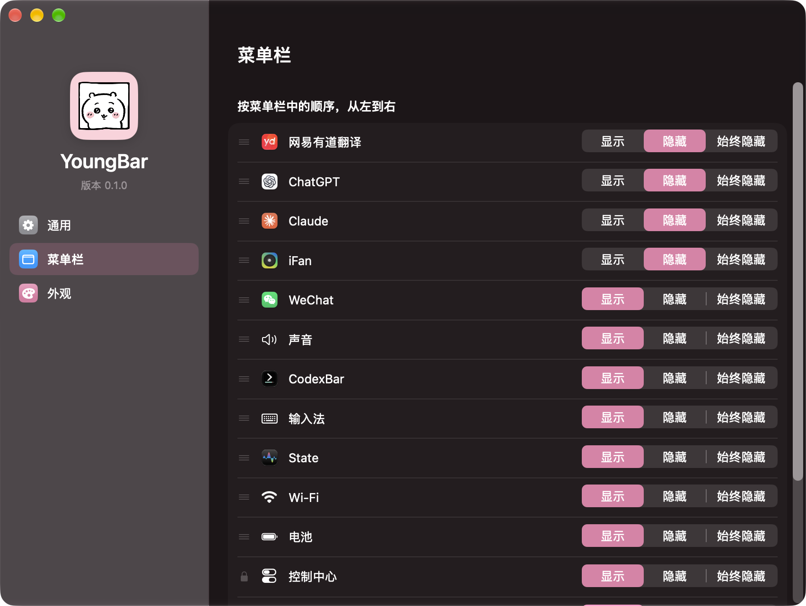
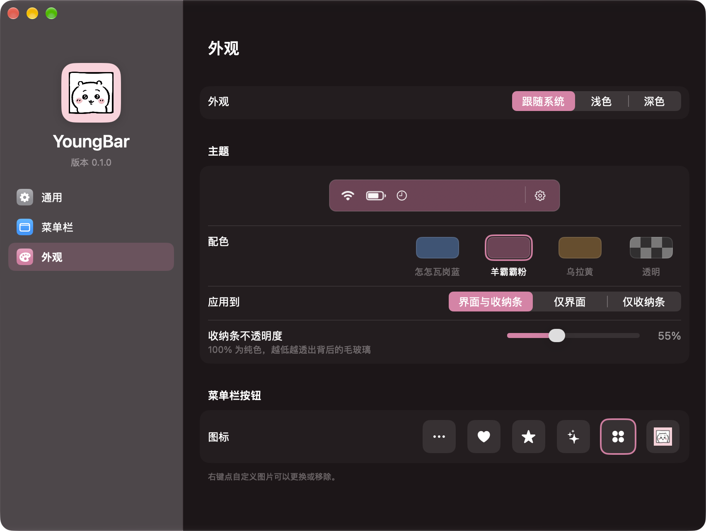
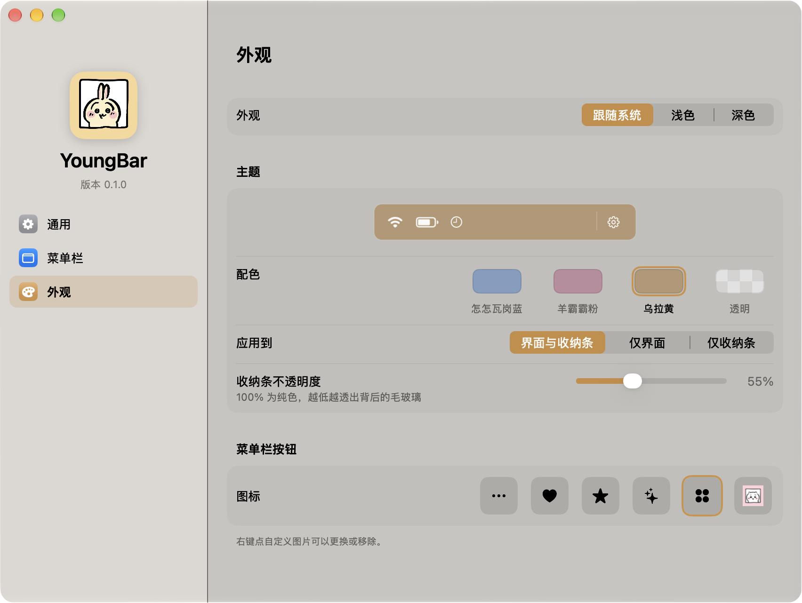

# YoungBar Journal

YoungBar 在 2026-10-23 从 Leorea 的 `youngbar/` 拆成独立仓库（保留历史）。
独立之前的第 1–147 轮记录在 Leorea 的 `docs/JOURNAL.md`；从本轮开始记在这里。

---

## 2026-10-23 · 独立仓库与 OPS 5.5 大改（观察记录）

- **仓库**：`~/Documents/General_Workspace/YoungBar`，私有远程
  [`51younglowkey/youngbar`](https://github.com/51younglowkey/youngbar)。
  观察时 `main` 与 `origin/main` 同步在 `8fab9f0`，工作区干净；远程 `pushedAt`
  为 2026-10-23T20:11:37Z。Leorea 内的旧 `youngbar/` 已由 `00e2b34` 删除，
  Leorea `README` 由 `7eaa2c6` 指向新仓库。
- **设置窗口**：`4605c70` 改为 SwiftUI `Form(.grouped)` + 侧栏 List，AppKit
  只保留 `NSWindow + NSSplitViewController` 外壳。三页：通用 / 菜单栏 / 外观；
  去掉手写坐标；每项显示状态改为一行菜单；语言原地刷新；窗口记住位置。
- **设置交互**：`f230584` 修正分组 Form 的 `onMove` 不响应拖动，改为
  `draggable + dropDestination`；新增 `YOUNGBAR_SETTINGSUITEST` 真机测试
  逐项模式、拖动、右键移动、切换语言，测试后恢复备份。证据
  `settingsuitest.json`：`modePassed/dragPassed/languagePassed:true`（02:30）。
- **外观**：`feeaf60` 把蓝/粉/黄统一为 OKLCH 同亮度同彩度；收纳条材质改为
  30–100% 不透明度滑块；恢复主题色玻璃、侧栏角色图、色块名字、40pt 图标格；
  分段按钮替代两步下拉。
- **收纳条**：`ea54e9c` 改为应用图标（系统项 SF Symbol），删除
  `StatusPictures.swift` 与截图缓存，**不再需要屏幕录制**；隐藏项点击改为
  直接 AXPress（不 reveal、不动鼠标、••• 不漂移）；系统项仍 reveal+点击。
  `870db8a` 把收纳条改回 ••• 正下方居中，并在 app 路径变化时自动重登登录项。
  `8fab9f0` 在按下前读 AX 位置，只有靠近 ••• 才原地按，否则显示后点击；
  诊断新增 `axX`。
- **构建**：`build.sh` 先组装/签名 staging 再整包替换，运行中重建不再被
  `Code Signature Invalid` 杀掉。App 用本地 `YoungBar Local Signing` 证书签名。
- **本轮核对**：`diagnostics.json` 20:07，`axTrusted:true`、`itemCount:11`；
  `settingsuitest.json` 02:30 全通过，但那之后 `ea54e9c` 删了设置里的屏幕录制行，
  **整套设置测试没有再跑**。当前版本 `0.1.0 (1)`。
- **登录项排查（2026-10-24）**：`sfltool dumpbtm` 里 YoungBar 的 URL 显示为
  `/Users/501/...`，而实际路径是 `<home>/...`；`launchctl print` 的
  `program` 指向当前 bundle。把登录项 token 改成「路径 + CFBundleVersion」，
  路径/版本变化时自动 unregister/register 一次；当前 `loginItemToken` 已更新。
  `who` 显示本机自 10-21 未重启，app 的 PPID 1 只能说明由 launchd 启动，
  **不能当作真实登录验证**；真实登出/重启仍未做。
- **仍然未验证 / 未做**：多显示器；图标间隙重启后的实际间距；开机自启动
  登出再登录；真实触控板拖动手感；英文菜单栏页截图；系统项 reveal+点击路径；
  可配置快捷键、键盘导航、收纳条内拖拽排序、配置导出。
- **文档整理**：`STATUS.md` 追加 4.7 当前基线，并明确 2 / 4.1–4.6 为历史；
  `README.md` 修正独立仓库的构建路径与 known gaps；`IBAR-FEATURES.md` 顶部
  标明 5.5 起不再截图/缓存；FAQ / INSTALL / SIGNING 删除了已不存在的
  屏幕录制与 `pictures.json` 缓存说明。旧缓存/屏幕录制/旧 AppKit 设置的描述保留为历史，
  不再作为现状。

---

## 2026-10-24 · 0.1.0 发布准备

- **Bundle ID**：`dev.leorea.youngbar` → `studio.wuyiyang.youngbar`。旧设置通过
  `UserDefaults(suiteName:)` 迁移到新域；启动后实测 `itemOrder` / `itemModes`
  已拷入 `studio.wuyiyang.youngbar`。改了身份，辅助功能需要重新授权一次，
  旧 `dev.leorea.youngbar` 登录项也要在系统设置里移除。
- **README**：加入四张真实截图（通用 / 菜单栏 / 黄色外观 / 透明外观），
  增加下载、权限、一键 Agent 安装、无 Dock 图标说明；构建路径改为仓库根目录。
- **安装**：新增 `Scripts/install.sh`，克隆到 `~/Applications/YoungBar-src`、
  构建、复制 `~/Applications/YoungBar.app` 并打开；辅助功能仍需用户手动授权。
- **发布包**：`Scripts/package.sh` 生成 `dist/YoungBar-0.1.0.zip` 和 SHA256
  `f83081e0f16e…`；zip 内 app 的 Bundle ID 已确认是 `studio.wuyiyang.youngbar`。
  尚未上传 GitHub Release（仓库仍为 private）。
- **仍未验证**：真实登出/重启后的登录启动、旧登录项清理、TCC 重新授权后的
  完整交互；多显示器等旧缺口不变。

---

## 2026-10-24 · 0.1.0 公开与作者历史清理

- 仓库转为 **Public**，发布 `v0.1.0`：<https://github.com/51younglowkey/youngbar/releases/tag/v0.1.0>
  资产 `YoungBar-0.1.0.zip` 与 `.sha256`；下载后 SHA256 与本地一致
  `f83081e0f16e7c7a761df90cf78276e6c6718dd7090e927f3ade17f255ea6bbe`。
- 重写了全部 41 个提交的作者/提交者：`YoungBar <youngbar@users.noreply.github.com>`；
  删除所有 `Co-Authored-By: Claude` trailer。GitHub contributors 现在只显示
  `Youngbar`，不再显示 `51young` / `Claude`。
- README 删除了 “YoungBar is a standalone repository, split out of the Leorea
  workspace with its history.” 这句。
- 注意：仓库 URL/所有者仍是 `51younglowkey`。要让 URL 里也不出现 51young，
  需要改 GitHub 用户名或把仓库转移到一个中性 org；这次没有动账号。
- 后续提交使用中性作者配置，避免旧名字重新出现在 contributors。

---

## 2026-10-24 · 中英双语 README 与截图排版

- `README.md` 改为默认中文；新增 `README.en.md` 英文版，顶部互相切换。
- 软件名在两版都保留 `YoungBar · 羊霸霸`，不拆成两个名字。
- 截图改为「一张大图 + 三张 32% 宽度横排」，不再四张纵向平铺；大图用粉色通用页，横排为菜单栏 / 黄色外观 / 透明外观。
- README 安装段去掉 Private 仓库的临时说法，改为手动 clone/构建。

---

## 2026-10-24 · 一键安装改为 Release 下载

- `Scripts/install.sh` 不再 `git clone` + `swift build`，改为下载
  `YoungBar-0.1.0.zip`、校验 SHA256、解压到 `~/Applications/YoungBar.app` 并打开。
  因此普通用户和 Agent 都不需要 Xcode Command Line Tools；只有从源码构建才需要。
- Release 的 `.sha256` 改成只含文件名，`shasum -a 256` 可直接在下载目录校验。

---

## 2026-10-24 · README 安装说明精简

- 安装只保留下载、解压、右键打开、辅助功能四步。
- Agent 安装改为一句自然语言 + 一行命令，举例 ChatGPT、豆包、
  Claude、DeepSeek（DSH）；不再解释 Xcode / 构建工具。
- 从源码构建只写「macOS 27 + Swift 6.3 工具链」。

- 2026-10-24 更正：作者身份最终改回仓库所有者 **51Young**
  `<193584257+51younglowkey@users.noreply.github.com>`，全部 46 个提交重写并
  force-push；GitHub 的 commit author 已链接到 `51younglowkey`。上一节里
  “重写为 YoungBar” 的记录仅代表中间状态。GitHub Contributors API 仍有
  旧缓存，显示 `Youngbar`，以提交页作者为准。

---

## 2026-10-29 · 0.1.1：构建修复、降 CPU、键盘搜索、溢出收纳

- **构建**：命令行工具在 2026-10-26 升到 Swift 6.4 后，`SettingsView.swift`
  里两处 `@State` 编不过（`SwiftUIMacros` 插件只随 Xcode 提供）。悬停与拖放高亮
  移进 `SettingsModel`，整个包不再用 `@State`。
- **CPU**：每秒一次的完整 AX 遍历 + 每秒重建设置模型，运行约 40 小时累计 41 分钟
  CPU（平均约 1.7%）。改为：收纳条/设置窗口打开或有定时展开时每秒一次，空闲每 4
  秒一次；应用启动/退出、唤醒、显示器变化立即刷新；设置窗口不可见时不重建模型；
  图标和应用名缓存。实测空闲 60 秒 0.32% / 0.33%。
- **测试钩子**：约 1100 行自检代码移到 `TestHooks.swift`，只在
  `TESTHOOKS=1 sh Scripts/build.sh` 时编译；正式版二进制里没有 `YOUNGBAR_*TEST`
  字符串，也不再链接 ScreenCaptureKit。
- **新功能**：收纳条键盘导航与搜索、自定义全局快捷键、放不下的图标进收纳条、
  首次启动引导、配置导入导出、「检查更新…」。
- **溢出的真实形态（更正设想）**：最初以为放不下的图标会滑到刘海下面。真机把所有
  隐藏项都显示出来后截图发现：macOS 27 会在刘海右侧放一个 «，放不下的图标收进 «
  的菜单，它们的 AX 位置都堆在 « 的位置上（YoungBar 自己的项 1008.5、有道 1014.5，
  第一个真实图标 Codex 1054.5）。检测改为 Pelmet 的「frame 互相重叠 > 4pt」规则，
  同时保留「minX 在刘海左侧」规则。同一轮发现 ••• 控件会跟着被收进 « 的项跑到刘海
  下面（x≈990），现在改为排除这些项，拥挤时缩窄并停在 « 左侧。
- **证据**：见 `docs/STATUS.md` 0.1.1 节。

---

## 附录：0.1.0 及之前的状态板（原 `docs/STATUS.md`，2026-10-24 前）

> 2026-10-29 从 `STATUS.md` 原样移来，只把标题降了一级。当前状态见 `STATUS.md`。

> 只描述这台 Mac 上的菜单栏工具。Windows 外设工作线见 [`docs/STATUS.md`](../../docs/STATUS.md)。
> 运行态由 `YOUNGBAR_DIAGNOSTICS=1` 写出：`~/Library/Application Support/YoungBar/diagnostics.json`；
> 一次性真机自检用 `YOUNGBAR_SELFTEST=1` 与 `YOUNGBAR_INTERACTIONTEST=1`，结果分别在 `selftest.json` / `interactiontest.json`。
>
> 最后核对：**2026-10-24 14:25 +01:00**

### 1. 构建

| 项 | 值 |
|---|---|
| 命令 | `cd youngbar && sh Scripts/build.sh` |
| 产物 | `build/YoungBar.app`（ad-hoc 签名） |
| 标识 | `studio.wuyiyang.youngbar`，显示名 **YoungBar**，版本 0.1.0 |
| 工具链 | Swift 6.3.3 / macOS 27.0.1 arm64 |
| 结果 | 构建通过（2026-10-21） |

构建脚本带 `--disable-sandbox`：SwiftPM 的 manifest 沙箱无法嵌套在 DSH 沙箱里，包本身没有 build plugin。
应用图标由用户提供的 `Resources/AppIcon-source.jpg` 经 `Scripts/make-icon.swift` 生成：粉色圆角底 + 完整手绘边框，输出 `Resources/AppIcon.icns`。

### 2. 真机状态

> 本节与 4.1–4.6 保留了 5.5 之前的阶段性记录，包含已删除的截图缓存/屏幕录制/旧 AppKit 设置窗口。**当前实现以 4.7 为准。**

| 项 | 状态 | 证据 |
|---|---|---|
| 启动 | ✅ 进程常驻，无崩溃 | `pgrep`；`log show --predicate 'process == "YoungBar"'` |
| 异常恢复 | ✅ 崩溃标记 → 启动先全部显示，再套用规则；`--reveal-all` 救援 | `recovery.json`：`crashed:true`、`concealedAfterReveal:0` |
| 正常退出 | ✅ 退出前全部显示，清掉会话标记 | `sessionActive:false` |
| 缓存上限 | ✅ 120 项 / 14 天 / 8 MB，超出丢最旧 | `StatusPictures` 策略；当前缓存 4 项 |
| 设置窗口 | ✅ 可纵向缩小，内容用 NSScrollView 滚动 | 窗口可 resize；默认 860×660 |
| 许可证合规 | ✅ GPL-3.0-only；LICENSE/NOTICES 打进 app bundle；SPDX 头 | `Scripts/verify.sh`；`THIRD_PARTY_NOTICES.md` |
| 自定义按钮 | ✅ 预设 / 自定义 PNG / 恢复默认 / 移除自定义 | `appearance.png` |
| 设置窗口 | ✅ 860×692（含标题栏），两页可渲染 | 窗口列表；`docs/images/settings-*.png` |
| 菜单栏控件 | ✅ 34×25，位于菜单栏内（y=7） | 窗口列表 layer 26 |
| 控件外观 | ✅ 模板 `ellipsis`，无底色 | 菜单栏截图（白点，无灰色胶囊） |
| 打开收纳条 | ✅ 21ms，且不临时显示任何图标 | `shelfopen.json`：`openMs:21`、`revealedOnOpen:0` |
| 原始图标缓存 | ✅ 落盘后点击不再抓图 | `~/Library/Application Support/YoungBar/pictures.json` |
| 动态项不缓存旧值 | ✅ 时钟/电池始终用符号回退 | `cachetest.json`：`clockCached:false` |
| 始终隐藏项原始图标 | ✅ 抓图覆盖「隐藏」与「始终隐藏」 | `alwayshiddentest.json`：`cachedForAlwaysHidden:true` |
| 清除缓存 | ✅ 文件与内存同时清除，可重建 | `cachetest.json`：`countAfterClear:0`、`cacheRestored:true` |
| 旧设置迁移 | ✅ `dev.leorea.bar` → `studio.wuyiyang.youngbar` | `defaults read studio.wuyiyang.youngbar` |
| 辅助功能 | ✅ 已授权 | diagnostics `"axTrusted": true` |
| 菜单栏项目读取 | ✅ 10 个在场项目 | diagnostics `"itemCount": 10` |
| 隐藏 → 展开 → 收起 | ✅ 真机通过 | `selftest.json`：`appeared: true`、`goneAgain: true` |
| 定时自动收起 | ✅ 20 秒到期后自动收起 | `selftest.json`：`expirySeconds: 20`、`autoHidden: true` |
| 收纳条 | ✅ 黑色圆角条 | `docs/images/shelf.png` |
| 图标体系 | ✅ 全 SF Symbols；锁定/拖动改为符号，没有 emoji | `docs/images/settings-layout.png` |
| 菜单栏按钮 | ✅ 5 个预设 + 自定义 PNG，已合并进外观页 | `docs/images/appearance-zh.png`、`menu-button-heart.png` |
| 统一窗口 | ✅ `fullSizeContentView`，无独立标题栏；红黄绿浮在玻璃上 | `docs/images/settings-unified.png` |
| 设置窗口玻璃 | ✅ `NSGlassEffectView` + 主题染色 + 深浅 scrim | `docs/images/settings-glass-{dark,light}.png` |
| 卡片式布局 | ✅ 每条独立圆角行，整行可拖，无表头/边框 |
| 一页布局 | ✅ 行高按项目数自动压缩，12 项一屏放下 | `docs/images/settings-layout.png` | `docs/images/settings-layout.png` |
| 布局顺序校准 | ✅ 新项按真实 x 插入；可见项每次刷新校准并持久化 | `itemOrder` 以有道翻译开头；`docs/images/settings-layout.png` |
| 外观主题 | ✅ 深/浅/跟随系统 + 4 主题（蓝/粉/黄/透明）+ 3 种收纳条；蓝色也遵守纯色/半透明/毛玻璃 | `shelf-{solid,translucent,glass}.png` | `docs/images/appearance-zh.png`、`appearance-en.png` |
| 语言 | ✅ 中文 / English，设置内切换并重建设置窗口 | `docs/images/general-en.png` |
| 主题图标 | ✅ 蓝猫 / 粉羊 / 黄兔 / 透明三小只随主题切换（侧栏、关于） | `appearance-{blue,pink,yellow}.png` |
| 主题应用范围 | ✅ 界面 + 收纳条 / 仅界面 / 仅收纳条 | `docs/images/appearance-zh.png` |
| 透明主题 | ✅ 跟随系统：深色玻璃白图标 / 浅色玻璃黑图标，界面中性 | `appearance-clear.png` | `docs/images/appearance-{dark,light}.png`、`shelf-sakura.png` |
| 关于窗口 | ✅ 菜单打开，显示版本 0.1.0 (3) | `abouttest.json`；`docs/images/about.png` |
| 全局快捷键 | ✅ ⌃⌥B 展开 / 收起，无需鼠标 | `hotkeytest.json`：`opened:true`、`closed:true`、`passed:true` |
| 收纳条齿轮 | ✅ 真实点击打开设置并收起收纳条 | `geartest.json`：`settingsOpened:true`、`shelfClosed:true`、`passed:true` |
| 展开时控件 | ✅ 保持 `ellipsis`，不再换成 `●` | `docs/images/shelf-expanded.png` |
| **原始菜单栏图标** | ✅ 屏幕录制授权后实测；缓存后点击不再重抓 | 收纳条显示 Claude 与 iFan 的原始菜单栏像素；`pictures.json` 缓存 |
| **真实点击（面板型）** | ✅ 点击送达 | `interactiontest.json`：点击后 AX 焦点归属 iFan（PID 94105），iFan 打开自己的面板 |
| **真实点击（菜单型）** | ✅ 点击 → 菜单 → Esc 关闭 → 状态恢复 | `menutest.json`：命中 `AXMenuItem`（TextInputMenuAgent），Esc 后 `AXGroup`，`restoredMode: true` |
| 展开时长 | ✅ 生产路径设为 20 秒 | 点击后 1 秒读回 `revealWindowSeconds: 19` |
| 点击后立即重新收纳 | ✅ 面板 / 菜单开着时均生效 | `concealtest.json`：`fanConcealedWhilePanelOpen:true`、`menuConcealedWhileOpen:true` |
| 全部隐藏 / 全部显示 | ✅ 真机通过，且不改写个人配置 | `bulktest.json`：藏起 9 项、全部显示后 0 项隐藏、恢复后回到 2 项，`modesUnchanged: true` |
| **排序（⌘ 拖动）** | ✅ 交换两项并拖回原位 | `ordertest.json`：`1311 < 1425` → `1397 ? 1327` → `restored: true`；当前 `1300 < 1338` |
| 固定项（时钟 / 控制中心） | ✅ 位置不可拖，但隐藏可用 | `pinnedtest.json`：`clockConcealed:true`、`controlCenterConcealed:true`、`restored:true` |
| 陈旧收纳项 | ✅ 已处理 | Codex 的保存项已不在菜单栏；现在从列表/收纳条移除；点击失败也会恢复收纳 |
| 开机自启动 | ✅ 已注册为登录项，未登出验证 | `sfltool dumpbtm`：YoungBar，`enabled, allowed` |
| 图标间隙写入 | ✅ 写入 / 读回 / 删除通过；菜单栏效果待重启 | `spacingtest.json`：写入 3/3、读回 3、随后删除 |

### 3. 验证边界（不许含糊）

- 2 秒与 20 秒两条到期路径都已跑通；20 秒那次是真实等待，不是估算。
- 图标间隙只验证了「写入→读回→删除」，**没有重启观察菜单栏实际间距**。
- 「点击 → 菜单 → Esc」已经用输入法状态项验证（见 `menutest.json` 与 `docs/images/menu-open.png`）；iFan 打开的是面板，不是菜单，但 conceal 行为没有区别。
- 开机自启动只验证了 BTM 注册，**没有真的登出再登录**。
- 排序只用一对相邻应用（WeChat ↔ CodexBar）验证过；◀ ▶ 按钮路径与多显示器仍未验证。
- 日期与控制中心的**位置**由 macOS 固定，任何第三方应用都拖不动；隐藏已验证可行。

### 4. 界面

### 4.1 更正（2026-10-23）：设置窗口改为 SwiftUI

上面第 2 节里「设置窗口（860×660 / 860×692）」「统一窗口」「设置窗口玻璃」「卡片式布局」「一页布局」五行描述的是旧的 AppKit 设置窗口，**已被替换**，以本节为准。

| 项 | 状态 | 证据 |
|---|---|---|
| 设置窗口结构 | ✅ NSSplitViewController：侧栏（SwiftUI List）+ 内容（SwiftUI Form .grouped），默认 760×620，最小 740×480，记住窗口位置 | `docs/images/swiftui-*.png` |
| 三页 | ✅ 通用 / 菜单栏 / 外观，深浅色、中英文都能渲染 | `YOUNGBAR_SETTINGS_PREVIEW` 截图 |
| 侧栏选中 / 标题 | ✅ 选中高亮；窗口标题随页面变化 | 同上 |
| 切换语言 | 🟡 已实现：原地刷新，不再销毁重建窗口 | **未在真机点过** |
| 菜单栏页排序 | 🟡 已实现：拖动（`onMove`）+ 右键「左移 / 右移 / 最左 / 最右」，不能移到固定项右边 | **未在真机拖过** |
| 每项显示 / 隐藏 / 始终隐藏 | 🟡 已实现：每行一个弹出菜单，替代两个复选框 | **未在真机切换过** |
| 「点击 ••• 时」选项 | ✅ 修正了旧界面的标签反转：旧的「聚合模式」实际写入 `nativeExpand=1`（在菜单栏中展开），见 `main.swift` 的 `toggleShelf` | 代码 |
| 自检钩子 | 🟡 `refreshButtonScreenRect` / `loginHitTest` 改为读 SwiftUI 控件的位置 | **`YOUNGBAR_SETTINGSCLICKTEST` 未重跑** |

已知差距：侧栏还不是 macOS 27 System Settings 那种悬浮玻璃面板（`scrollContentBackground(.hidden)` 试过无效）；第一张卡片比系统设置靠下约 20pt（`contentMargins(.top, 0)` 试过无效）。

### 4.2 更正（2026-10-23，真机交互验证）

4.1 节里标 🟡 的几项已在真机用真实鼠标/键盘事件验证，结论如下（`YOUNGBAR_SETTINGSUITEST=1`，结果 `~/Library/Application Support/YoungBar/settingsuitest.json`）：

| 项 | 状态 | 证据 |
|---|---|---|
| 每项「显示 / 隐藏 / 始终隐藏」菜单 | ✅ WeChat：显示→隐藏→始终隐藏→隐藏→显示，四步界面与存档一致 | `modeSteps`、`modePassed:true` |
| 拖动排序 | ✅ **改了实现**：分组表单里的 `onMove` 不响应拖动（真机实测 `dragPassed:false`），改为 `draggable` + `dropDestination`，拖到某行上即占那一行的位置；WeChat 拖到 CodexBar 上后菜单栏顺序真实改变 | `orderBefore [4,6]` → `orderAfterDrag [6,5]`、「顺序已应用到菜单栏」 |
| 右键移动 | ✅「左移一位」「右移一位」都真实改动菜单栏顺序，并移回原位 | `contextSteps`、`contextPassed:true` |
| 切换语言 | ✅ 中文→English→中文，同一个窗口、位置不变、标题跟着变 | `languageSteps`：`sameWindow:true`、`frameUnchanged:true` |
| 测试后复原 | ✅ 模式、顺序、外观选项、隐藏列表与测试前备份逐项相同 | `defaults export` 前后对比 |

同一轮发现并修好的问题：

- **构建会杀掉正在运行的 YoungBar**：`build.sh` 原地覆盖可执行文件，运行中的进程被系统以 `SIGKILL (Code Signature Invalid)` 杀掉，跳过退出时的全部显示（2026-10-23 00:19–00:59 的几份崩溃报告都是这个原因，不是代码崩溃）。现在先组装、签名到 `build/YoungBar.app.staging`，再整包替换。
- **错误提示**：移动到一个当前不在菜单栏里的项目旁边时，原来提示「日期和控制中心的位置由 macOS 固定」，现在提示「目标位置旁边的项目当前不在菜单栏中」。
- **自检本身**：只在确认菜单真的弹出后才发送按键。早一版没有这个检查，菜单没弹出时方向键和回车落到了别的控件上，改动了「应用到」和「收纳条材质」，已按备份恢复。

仍未验证：用手（真实触控板）拖动时的视觉反馈是否顺手；英文界面下菜单栏页的布局截图。

### 4.3 更正（2026-10-23，配色统一与旧版个性回归）

| 项 | 状态 | 证据 |
|---|---|---|
| 三种配色统一 | ✅ 蓝 / 粉 / 黄改为 OKLCH 同亮度同彩度（原来蓝色亮度约 0.7、毛玻璃染色 55%，粉黄亮度约 0.3、染色 18%） | `Theme.swift` 注释；`docs/images/swiftui-appearance-*.png` |
| 收纳条材质 | ✅ 「纯色 / 半透明 / 毛玻璃」改为一个不透明度滑块（30–100%）；旧设置自动换算（纯色 100、半透明 72、毛玻璃 55） | `stripOpacityPercent`；用户原设置「毛玻璃」→ 55% |
| 窗口玻璃 | ✅ 恢复旧版的主题色玻璃与遮罩数值；侧栏改为系统侧栏毛玻璃（参照 DeepSeek Harness 左栏） | 截图 |
| 旧版个性 | ✅ 侧栏顶部 72pt 主题角色大图 + 名称 + 版本；主题色选中底；色块下写名字；40pt 图标格；页面标题放回内容区 | 截图 |
| 少一步点击 | ✅ 菜单栏每项、点击 ••• 时、图标间隙、应用到 都改为分段按钮；只有语言保留弹出菜单 | 截图 |
| 真机交互 | ✅ 逐项模式（三按钮）、拖动、右键移动、切换语言全部通过，测试后四项设置与备份一致 | `settingsuitest.json`（语言一步加了一次重试，本轮都是第一次成功） |

### 4.4 更正（2026-10-23，收纳条点开方式与图标）

| 项 | 状态 | 证据 |
|---|---|---|
| 点收纳条里的第三方项 | ✅ 隐藏状态下直接 AXPress：不 reveal、鼠标不动、••• 不漂移；ChatGPT 菜单、iFan 面板、Claude 窗口都在收纳条旁打开 | 真机记录：`path: press`、`mouseMoved: false`、`revealed: false`，控制条位置前后一致 |
| 系统项（Wi-Fi 等） | 🟡 仍 reveal + 点击，点击时隐藏光标 | 未单独真机验证 |
| 收纳条位置 | ✅ 向 ••• 左侧展开，打开的菜单/面板在其右侧，不再盖住收纳条 | 截图记录 |
| 面板盖住收纳条 | ✅ 收纳条排到新面板正下方 | iFan 面板（第 0 层）在收纳条之上 |
| 收纳条内容 | ✅ 改为应用图标（系统项为 SF Symbol）。**更正**：之前的「原始菜单栏像素缓存」已删除，屏幕录制权限不再需要 | 用户否决截图方案：分辨率低、发糊；`StatusPictures.swift` 已移除 |
| ••• 位置 | ✅ 修复：一度改成 `animator()` 动画后不再移动、停在菜单栏中间；改为 `setFrame(animate:)` | 菜单栏截图：••• 紧贴最左侧图标 |
| ••• 改用原生状态项 | ❌ 走不通：隐藏断言生效时系统给它分配了位置但不绘制 | 实验：窗口 frame 在菜单栏内，截图中不可见 |
| 构建 | ✅ `build.sh` 改为 staging 后整包替换，运行中重建不再被 `Code Signature Invalid` 杀掉 | 崩溃报告对比 |

### 4.5 更正（2026-10-23）

- 收纳条位置：4.4 节的「向 ••• 左侧展开」按用户要求改回**在 ••• 正下方居中**。代价：打开靠右的菜单/面板时可能盖住收纳条右半边。
- 仓库移到 `~/Documents/General_Workspace/YoungBar`。登录项记录的是 app 路径，移动后会失效；现在启动时若发现路径变了会自动重新登记（`sfltool dumpbtm` 已显示新路径、enabled）。

### 4.6 更正（2026-10-23）

- 从收纳条原地打开时，菜单一度弹到屏幕最左边（用户报告，未当场复现；当时诊断中的隐藏项位置正常：ChatGPT 1172、Claude 1202、iFan 1250）。现在按下前先读该项的 AX 位置，只有在 ••• 附近（屏幕右半、相距 < 400pt）才原地按下，否则改为显示后点击。用户复测：菜单都在收纳条附近弹出。
- 诊断（`YOUNGBAR_DIAGNOSTICS=1`）新增 `axX`：各项自己报告的 AX 位置，隐藏时也有。

### 5. 下一步

1. 重启验证图标间隙四档；登出验证开机自启动。
2. 多显示器。
4. 在第二块显示器上重复布局与收纳。

### 4.7 当前基线（2026-10-23 21:20，5.5 大改后）

> 这一节是独立仓库后的当前状态；上面的 2 / 4.1–4.6 是历史阶段，不再作为现状依据。

| 项 | 当前状态 | 证据 |
|---|---|---|
| 仓库 | `~/Documents/General_Workspace/YoungBar`，公开远程 `51younglowkey/youngbar`；0.1.0 已发布 | `git status -sb`；`gh repo view` |
| 版本 / Bundle ID | `0.1.0 (1)`，显示名 YoungBar；Bundle ID 改为 `studio.wuyiyang.youngbar` | `Info.plist`；旧 `dev.leorea.youngbar` 设置会迁移（已实测 `itemOrder` 拷入新域） |
| 构建 | `Scripts/build.sh` 先组装 + 签名 staging，再整包替换；运行中重建不再被 `Code Signature Invalid` 杀掉 | `Scripts/build.sh`；4.2 的崩溃对比 |
| 0.1.0 发布包 | ✅ 已上传 GitHub Release（公开）；`YoungBar-0.1.0.zip` + `.sha256`，bundle 内带 LICENSE/NOTICES | [Release v0.1.0](https://github.com/51younglowkey/youngbar/releases/tag/v0.1.0)；SHA256 `f83081e0…` |
| 签名 | 本地 `YoungBar Local Signing` 证书（非 Developer ID）；bundle 内带 LICENSE/NOTICES | `codesign -dv`：`Authority=YoungBar Local Signing` |
| 设置窗口 | **SwiftUI** `Form(.grouped)` + 侧栏 List，AppKit 只做 `NSWindow + NSSplitViewController` 外壳；三页：通用 / 菜单栏 / 外观 | `Sources/YoungBar/SettingsView.swift`、`BarSettings.swift`；`swiftui-*.png` |
| 设置交互 | 逐项模式菜单、拖动排序、右键移动、原地切换语言均通过真实鼠标/键盘测试；测试后设置与备份一致 | `settingsuitest.json`（`modePassed/dragPassed/languagePassed:true`，02:30；之后 `ea54e9c` 删了屏幕录制行，未重跑整套设置测试） |
| 收纳条内容 | 应用图标（系统项 SF Symbol），**不再截图/缓存，不需要屏幕录制** | `StatusPictures.swift` 已删除；README；4.4 |
| 点隐藏项 | 第三方项在隐藏状态下直接 AXPress：不 reveal、鼠标不动、••• 不漂移；系统项仍 reveal + 点击 | `ea54e9c` 真机记录；`axX` 诊断 |
| 收纳条位置 | 在 ••• 正下方居中；固定到关闭 | `870db8a`；4.5 |
| 菜单偏移保护 | 按下前读 AX 位置，只有靠近 •••（屏幕右半、<400pt）才原地按，否则显示后点击 | `8fab9f0`；`axX` |
| 菜单栏读取 | 本机 11 项，辅助功能已授权 | `diagnostics.json`（20:07；`itemCount:11`、`axTrusted:true`） |
| 登录项 | 🟡 新 Bundle ID 需要重新打开「登录时打开」；旧 `dev.leorea.youngbar` 的登录项需要在系统设置里移除。路径/版本 token 变化会自动重登。**真实登出/重启仍未验证** | `loginItemToken`；`launchctl print` |
| 外观 | 蓝/粉/黄 OKLCH 同亮度同彩度 + 中性透明；收纳条不透明度 30–100%；主题色玻璃、侧栏角色图 | 4.3；`swiftui-appearance-*.png` |
| 已知未验证 | 多显示器；图标间隙需重启观察；开机自启动需登出再登录；真实触控板拖动手感；英文菜单栏页截图；系统项 reveal+点击路径 | 4.2/4.4/4.6 |
| 已知功能缺口 | 可配置快捷键、键盘导航、收纳条内拖拽排序、通知/配置导出 | README Roadmap |

#### 已废弃的旧记录

- 屏幕录制、`StatusPictures`、`pictures.json`、120 项/14 天/8 MB 缓存、`cachetest` 都属于 5.5 之前的实现，已随 `ea54e9c` 删除。
- 旧 AppKit 设置窗口的 860×660 / 860×692、NSScrollView、固定 header 等记录，已被 4.1 的 SwiftUI 设置替换。
- 旧的「原始菜单栏像素」描述不再是当前产品行为；当前收纳条显示应用图标，不是菜单栏截图。

