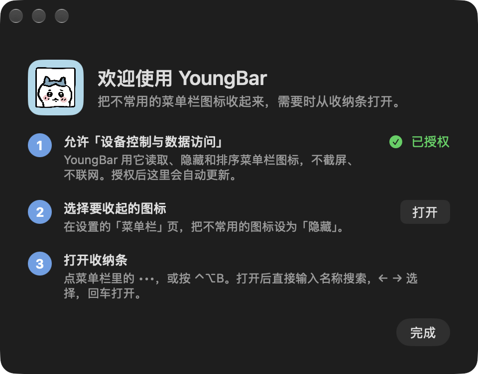
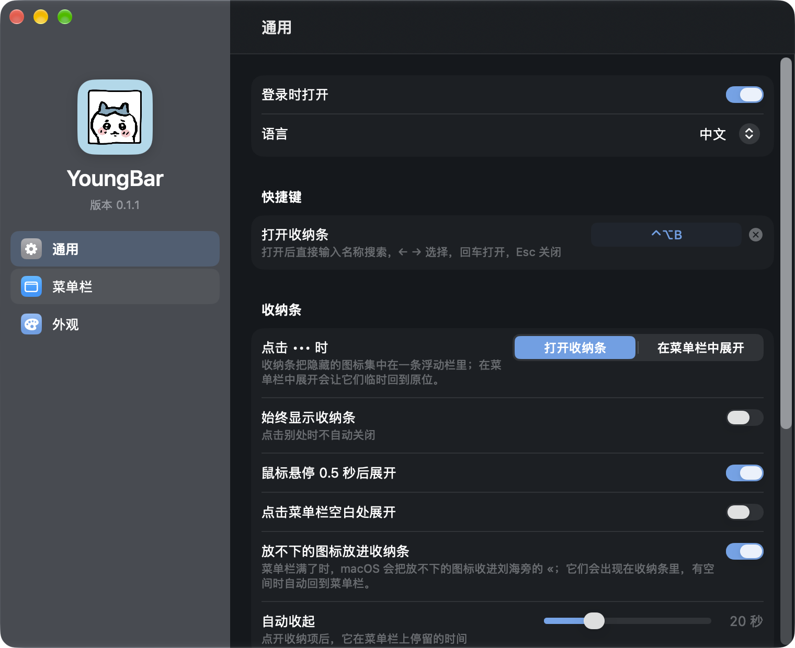

# YoungBar（羊霸霸）状态板

> 只写**当前**状态和它的证据。0.1.0 及之前的阶段记录（截图缓存、旧 AppKit 设置窗口等）
> 已原样移到 [`JOURNAL.md`](JOURNAL.md) 附录。
>
> 最后核对：**2026-10-29 21:00 +00:00**，版本 **0.1.1 (2)**，MacBook 内建屏（1800×1169，刘海 790–1010pt），macOS 27。

## 1. 构建

| 项 | 值 | 证据 |
|---|---|---|
| 命令 | `sh Scripts/build.sh` → `build/YoungBar.app` | 构建通过（2026-10-29） |
| 工具链 | 只需命令行工具：Swift 6.4（CLT 27.0，2026-10-26 安装），**不需要 Xcode** | `swift --version`；包内不再使用 `@State`（宏插件只随 Xcode） |
| 测试版构建 | `TESTHOOKS=1 sh Scripts/build.sh`：编入 `TestHooks.swift` 的真机自检 | 正式版 `strings` 中 `YOUNGBAR_*TEST` 0 处；`otool -L` 无 ScreenCaptureKit |
| 单元测试 | `swift test --disable-sandbox`：17 项（排序、溢出判断、快捷键、配置文件） | 17 passed |
| 签名 | 本地 `YoungBar Local Signing` 证书；重建后辅助功能授权保持 | `codesign -dv`；重建后自检仍 `axTrusted:true` |

## 2. 当前行为与证据（0.1.1）

| 项 | 状态 | 证据 |
|---|---|---|
| 空闲 CPU | ✅ 0.32–0.33%（0.1.0：约 1.7%，40 小时累计 41 分钟） | 60 秒 `ps -o time` 差值，两次 |
| 刷新节奏 | ✅ 收纳条/设置打开或有定时展开时 1 秒；空闲 4 秒；应用启动退出、唤醒、显示器变化立即刷新 | `refreshInterval`、`startRefreshTriggers` |
| 快捷键打开收纳条 | ✅ 真实按键 ⌃⌥B 打开，收纳条成为键盘焦点，前台应用不变 | `keyboardtest.json`：`openedByShortcut`、`stripIsKey`、`frontAppStillFront` |
| 键盘导航 | ✅ 打开即选中第一项；→ 1、←← 绕回 4；Esc 先清搜索再关闭 | `selectionAfterOpen:0`、`selectionAfterRight:1`、`selectionAfterTwoLeft:4`、`queryClearedByEsc`、`closedByEsc` |
| 搜索 | ✅ 输入 "ifa" 只剩 iFan 且被选中；⌫ 删一字；无匹配显示「没有匹配的项目」 | `matches`、`searchFoundTarget`、`queryAfterDelete:"if"`、`noMatchCount:0`； |
| 自定义快捷键 | ✅ 改成 ⌃⌥⌘Y 后真实按键能打开、旧的 ⌃⌥B 失效；测试后恢复 ⌃⌥B | `openedByCustom`、`oldShortcutIgnored`、`restoredDisplay`；8 组组合各按一次均打开 1 次（`hotkeyprobe.json`） |
| 放不下的图标 | ✅ 把 5 个隐藏项临时全部显示：macOS 把有道收进 «，YoungBar 识别并列进收纳条；恢复后为空 | `overflowtest.json`：`overflowAllShown:[有道]`、`stripListsOverflow`、`restored`、`overflowAfter:[]` |
| 拥挤时的 ••• | ✅ 不再跟着被收进 « 的项跑到刘海下面；缩窄后停在 « 左侧 |  |
| 配置导入导出 | ✅ 导出 → 改一个选项 → 导入，模式、选项、顺序全部还原 | `configtest.json`：`passed:true` |
| 首次启动引导 | ✅ 新安装显示；老用户升级自动标记已看过；授权状态每秒刷新 |  |
| 收纳条打开 | ✅ 21ms，不临时显示任何图标 | `shelfopen.json`：`openMs:21`、`revealedOnOpen:0` |
| 显示 → 自动收起 | ✅ | `selftest.json`：`appeared`、`autoHidden`、`goneAgain` |
| 测试后复原 | ✅ `itemModes`、`hiddenBundles` 与测试前备份相同；`barOptions` 只多了 `onboarded:1` | `defaults export` 前后对比 |

## 3. 验证边界（不许含糊）

- **多显示器没有验证**（手头只有内建屏）。已做的只是代码层面：显示器增减时把控件放回状态项旁；
  空白处点击、溢出判断只看控件所在那块屏；兜底位置用主屏而不是「当前有键盘焦点的屏」。
- 溢出只在「把隐藏项全部显示」这一种拥挤方式下实测过一次；被 « 收走的是有道。
  « 菜单里的项从收纳条点开时走 AXPress，没有单独真机点过。
- 键盘测试中收纳条里的按键是直接送给处理函数的（不是真实键盘事件），只有快捷键本身是真实按键。
  第一次跑自定义快捷键时 ⌃⌥⌘Y 有一次没打开，之后 3 轮共 10 次都正常；推测是测试期间有真实鼠标点击把收纳条关了，未确认。
- 系统级快捷键（如输入法切换）会抢在 YoungBar 之前，注册时 macOS 不报冲突，所以这种冲突检测不到。
- 设置测试（`YOUNGBAR_SETTINGSUITEST`，真实鼠标）本轮没有重跑：它会接管鼠标。
- 图标间隙需要重启才能看到效果；开机自启动没有真的登出再登录过。
- 一次重启后，两个隐藏项（Figma、iFan）的保存顺序按 macOS 的实际顺序校准了，与测试前备份不同；这是既有的「顺序跟随真实菜单栏」行为。

## 4. 下一步

1. 有第二块显示器时验证：控件、收纳条位置、点开隐藏项。
2. 从收纳条点开被 « 收走的项。
3. 重启验证图标间隙；登出验证开机自启动。
