# YoungBar（羊霸霸）状态板

> 只描述这台 Mac 上的菜单栏工具。Windows 外设工作线见 [`docs/STATUS.md`](../../docs/STATUS.md)。
> 运行态由 `YOUNGBAR_DIAGNOSTICS=1` 写出：`~/Library/Application Support/YoungBar/diagnostics.json`；
> 一次性真机自检用 `YOUNGBAR_SELFTEST=1` 与 `YOUNGBAR_INTERACTIONTEST=1`，结果分别在 `selftest.json` / `interactiontest.json`。
>
> 最后核对：**2026-10-22 22:25 +01:00**

## 1. 构建

| 项 | 值 |
|---|---|
| 命令 | `cd youngbar && sh Scripts/build.sh` |
| 产物 | `build/YoungBar.app`（ad-hoc 签名） |
| 标识 | `dev.leorea.youngbar`，显示名 **YoungBar**，版本 0.1.0 |
| 工具链 | Swift 6.3.3 / macOS 27.0.1 arm64 |
| 结果 | 构建通过（2026-10-21） |

构建脚本带 `--disable-sandbox`：SwiftPM 的 manifest 沙箱无法嵌套在 DSH 沙箱里，包本身没有 build plugin。
应用图标由用户提供的 `Resources/AppIcon-source.jpg` 经 `Scripts/make-icon.swift` 生成：粉色圆角底 + 完整手绘边框，输出 `Resources/AppIcon.icns`。

## 2. 真机状态

| 项 | 状态 | 证据 |
|---|---|---|
| 启动 | ✅ 进程常驻，无崩溃 | `pgrep`；`log show --predicate 'process == "YoungBar"'` |
| 异常恢复 | ✅ 崩溃标记 → 启动先全部显示，再套用规则；`--reveal-all` 救援 | `recovery.json`：`crashed:true`、`concealedAfterReveal:0` |
| 正常退出 | ✅ 退出前全部显示，清掉会话标记 | `sessionActive:false` |
| 缓存上限 | ✅ 120 项 / 14 天 / 8 MB，超出丢最旧 | `StatusPictures` 策略；当前缓存 4 项 |
| 设置窗口 | ✅ 可纵向缩小，内容用 NSScrollView 滚动 | 窗口可 resize；默认 860×660 |
| 许可证合规 | ✅ GPL-3.0-only；LICENSE/NOTICES 打进 app bundle；SPDX 头 | `Scripts/verify.sh`；`THIRD_PARTY_NOTICES.md` |
| 自定义按钮 | ✅ 预设 / 自定义 PNG / 恢复默认 / 移除自定义 | `appearance.png` |
| 设置窗口 | ✅ 860×692（含标题栏），两页可渲染 | 窗口列表；`docs/images/settings-*.png` |
| 菜单栏控件 | ✅ 34×25，位于菜单栏内（y=7） | 窗口列表 layer 26 |
| 控件外观 | ✅ 模板 `ellipsis`，无底色 | 菜单栏截图（白点，无灰色胶囊） |
| 打开收纳条 | ✅ 21ms，且不临时显示任何图标 | `shelfopen.json`：`openMs:21`、`revealedOnOpen:0` |
| 原始图标缓存 | ✅ 落盘后点击不再抓图 | `~/Library/Application Support/YoungBar/pictures.json` |
| 动态项不缓存旧值 | ✅ 时钟/电池始终用符号回退 | `cachetest.json`：`clockCached:false` |
| 始终隐藏项原始图标 | ✅ 抓图覆盖「隐藏」与「始终隐藏」 | `alwayshiddentest.json`：`cachedForAlwaysHidden:true` |
| 清除缓存 | ✅ 文件与内存同时清除，可重建 | `cachetest.json`：`countAfterClear:0`、`cacheRestored:true` |
| 旧设置迁移 | ✅ `dev.leorea.bar` → `dev.leorea.youngbar` | `defaults read dev.leorea.youngbar` |
| 辅助功能 | ✅ 已授权 | diagnostics `"axTrusted": true` |
| 菜单栏项目读取 | ✅ 10 个在场项目 | diagnostics `"itemCount": 10` |
| 隐藏 → 展开 → 收起 | ✅ 真机通过 | `selftest.json`：`appeared: true`、`goneAgain: true` |
| 定时自动收起 | ✅ 20 秒到期后自动收起 | `selftest.json`：`expirySeconds: 20`、`autoHidden: true` |
| 收纳条 | ✅ 黑色圆角条 | `docs/images/shelf.png` |
| 图标体系 | ✅ 全 SF Symbols；锁定/拖动改为符号，没有 emoji | `docs/images/settings-layout.png` |
| 菜单栏按钮 | ✅ 5 个预设 + 自定义 PNG，已合并进外观页 | `docs/images/appearance-zh.png`、`menu-button-heart.png` |
| 统一窗口 | ✅ `fullSizeContentView`，无独立标题栏；红黄绿浮在玻璃上 | `docs/images/settings-unified.png` |
| 设置窗口玻璃 | ✅ `NSGlassEffectView` + 主题染色 + 深浅 scrim | `docs/images/settings-glass-{dark,light}.png` |
| 卡片式布局 | ✅ 每条独立圆角行，整行可拖，无表头/边框 |
| 一页布局 | ✅ 行高按项目数自动压缩，12 项一屏放下 | `docs/images/settings-layout.png` | `docs/images/settings-layout.png` |
| 布局顺序校准 | ✅ 新项按真实 x 插入；可见项每次刷新校准并持久化 | `itemOrder` 以有道翻译开头；`docs/images/settings-layout.png` |
| 外观主题 | ✅ 深/浅/跟随系统 + 4 主题（蓝/粉/黄/透明）+ 3 种收纳条；蓝色也遵守纯色/半透明/毛玻璃 | `shelf-{solid,translucent,glass}.png` | `docs/images/appearance-zh.png`、`appearance-en.png` |
| 语言 | ✅ 中文 / English，设置内切换并重建设置窗口 | `docs/images/general-en.png` |
| 主题图标 | ✅ 蓝猫 / 粉羊 / 黄兔 / 透明三小只随主题切换（侧栏、关于） | `appearance-{blue,pink,yellow}.png` |
| 主题应用范围 | ✅ 界面 + 收纳条 / 仅界面 / 仅收纳条 | `docs/images/appearance-zh.png` |
| 透明主题 | ✅ 跟随系统：深色玻璃白图标 / 浅色玻璃黑图标，界面中性 | `appearance-clear.png` | `docs/images/appearance-{dark,light}.png`、`shelf-sakura.png` |
| 关于窗口 | ✅ 菜单打开，显示版本 0.1.0 (3) | `abouttest.json`；`docs/images/about.png` |
| 全局快捷键 | ✅ ⌃⌥B 展开 / 收起，无需鼠标 | `hotkeytest.json`：`opened:true`、`closed:true`、`passed:true` |
| 收纳条齿轮 | ✅ 真实点击打开设置并收起收纳条 | `geartest.json`：`settingsOpened:true`、`shelfClosed:true`、`passed:true` |
| 展开时控件 | ✅ 保持 `ellipsis`，不再换成 `●` | `docs/images/shelf-expanded.png` |
| **原始菜单栏图标** | ✅ 屏幕录制授权后实测；缓存后点击不再重抓 | 收纳条显示 Claude 与 iFan 的原始菜单栏像素；`pictures.json` 缓存 |
| **真实点击（面板型）** | ✅ 点击送达 | `interactiontest.json`：点击后 AX 焦点归属 iFan（PID 94105），iFan 打开自己的面板 |
| **真实点击（菜单型）** | ✅ 点击 → 菜单 → Esc 关闭 → 状态恢复 | `menutest.json`：命中 `AXMenuItem`（TextInputMenuAgent），Esc 后 `AXGroup`，`restoredMode: true` |
| 展开时长 | ✅ 生产路径设为 20 秒 | 点击后 1 秒读回 `revealWindowSeconds: 19` |
| 点击后立即重新收纳 | ✅ 面板 / 菜单开着时均生效 | `concealtest.json`：`fanConcealedWhilePanelOpen:true`、`menuConcealedWhileOpen:true` |
| 全部隐藏 / 全部显示 | ✅ 真机通过，且不改写个人配置 | `bulktest.json`：藏起 9 项、全部显示后 0 项隐藏、恢复后回到 2 项，`modesUnchanged: true` |
| **排序（⌘ 拖动）** | ✅ 交换两项并拖回原位 | `ordertest.json`：`1311 < 1425` → `1397 ? 1327` → `restored: true`；当前 `1300 < 1338` |
| 固定项（时钟 / 控制中心） | ✅ 位置不可拖，但隐藏可用 | `pinnedtest.json`：`clockConcealed:true`、`controlCenterConcealed:true`、`restored:true` |
| 陈旧收纳项 | ✅ 已处理 | Codex 的保存项已不在菜单栏；现在从列表/收纳条移除；点击失败也会恢复收纳 |
| 开机自启动 | ✅ 已注册为登录项，未登出验证 | `sfltool dumpbtm`：YoungBar，`enabled, allowed` |
| 图标间隙写入 | ✅ 写入 / 读回 / 删除通过；菜单栏效果待重启 | `spacingtest.json`：写入 3/3、读回 3、随后删除 |

## 3. 验证边界（不许含糊）

- 2 秒与 20 秒两条到期路径都已跑通；20 秒那次是真实等待，不是估算。
- 图标间隙只验证了「写入→读回→删除」，**没有重启观察菜单栏实际间距**。
- 「点击 → 菜单 → Esc」已经用输入法状态项验证（见 `menutest.json` 与 `docs/images/menu-open.png`）；iFan 打开的是面板，不是菜单，但 conceal 行为没有区别。
- 开机自启动只验证了 BTM 注册，**没有真的登出再登录**。
- 排序只用一对相邻应用（WeChat ↔ CodexBar）验证过；◀ ▶ 按钮路径与多显示器仍未验证。
- 日期与控制中心的**位置**由 macOS 固定，任何第三方应用都拖不动；隐藏已验证可行。

## 4. 界面

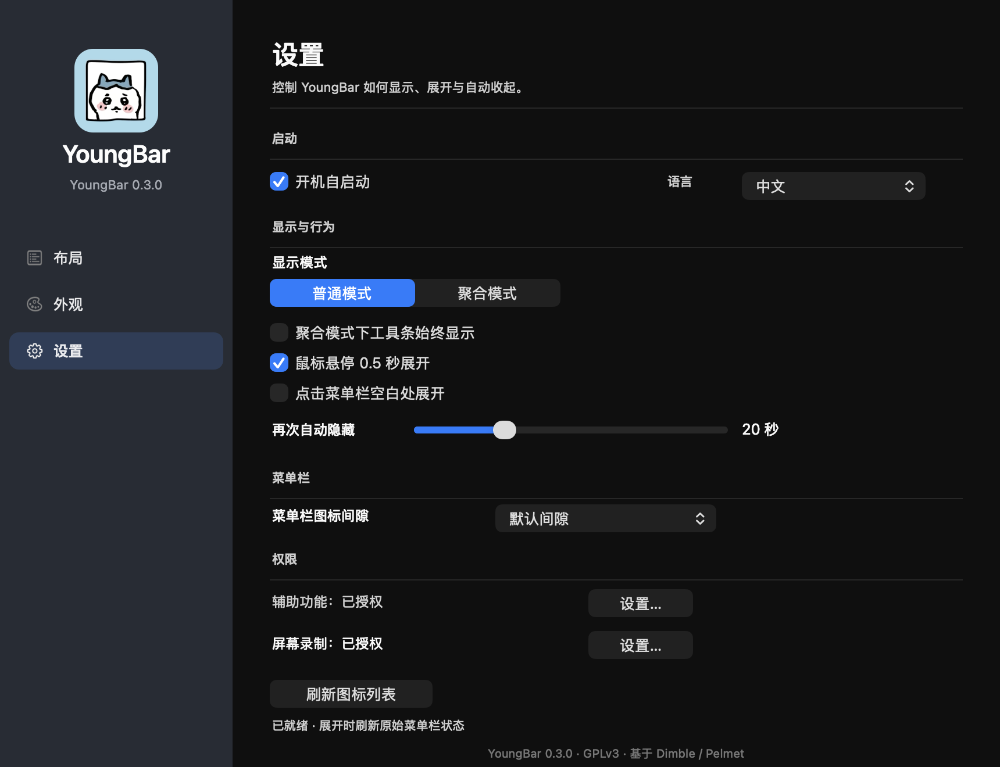

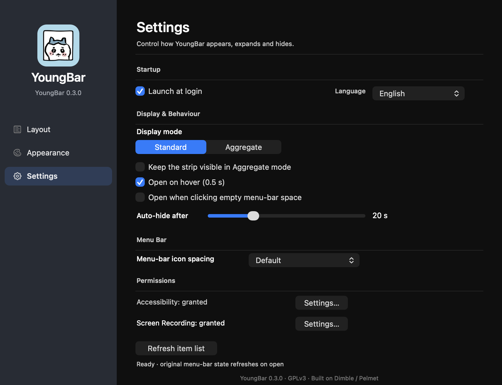

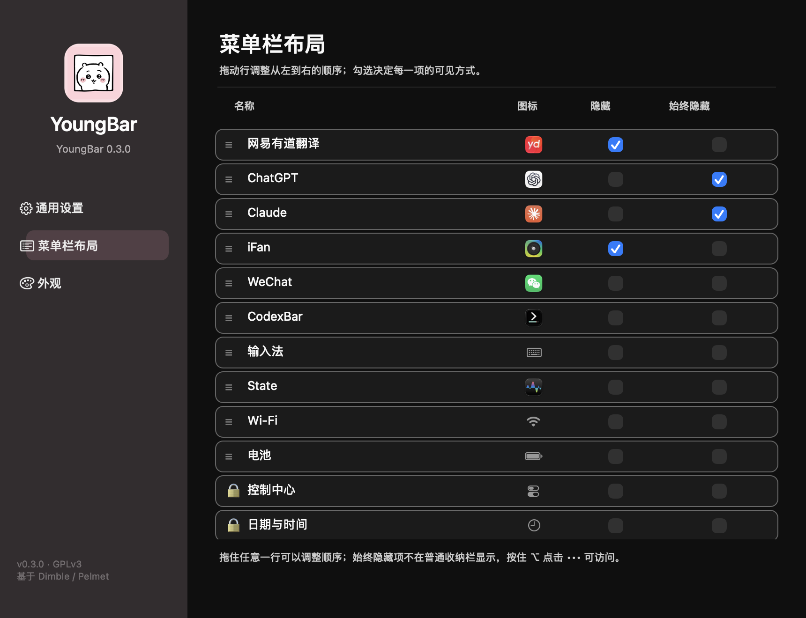

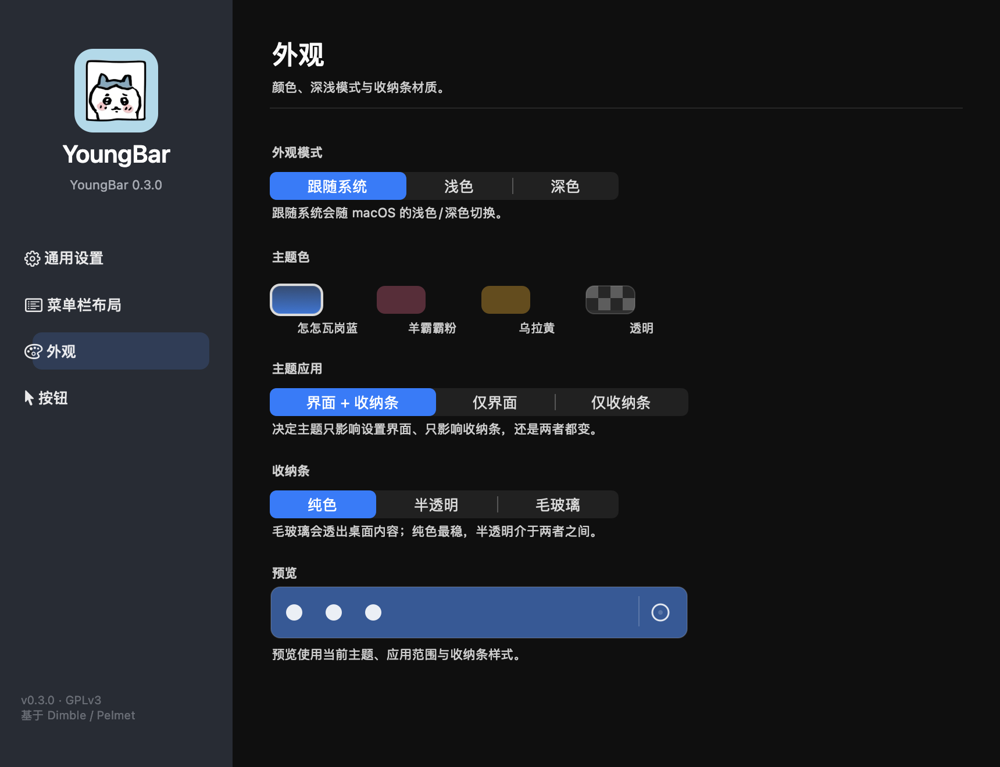

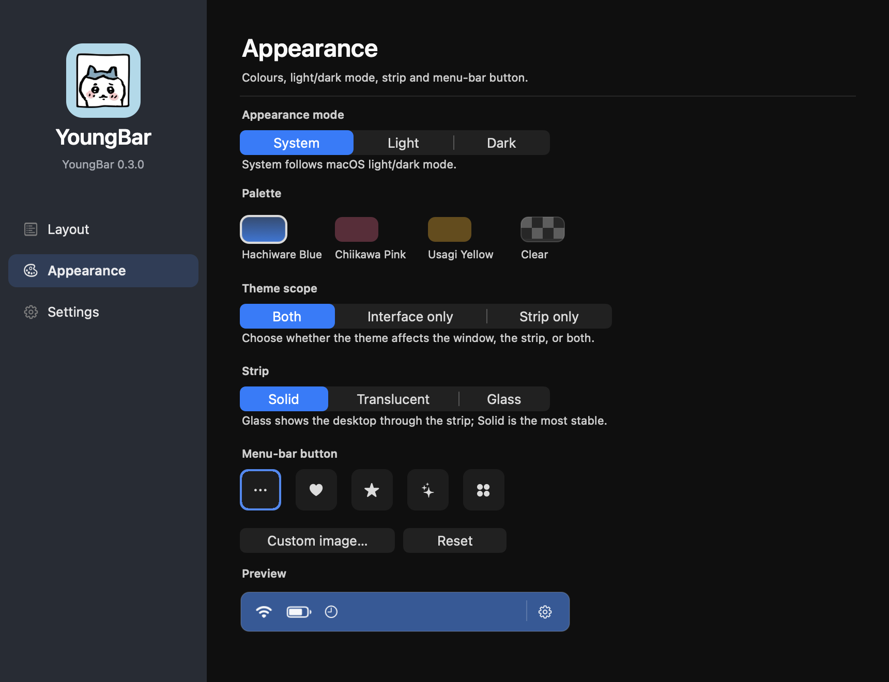

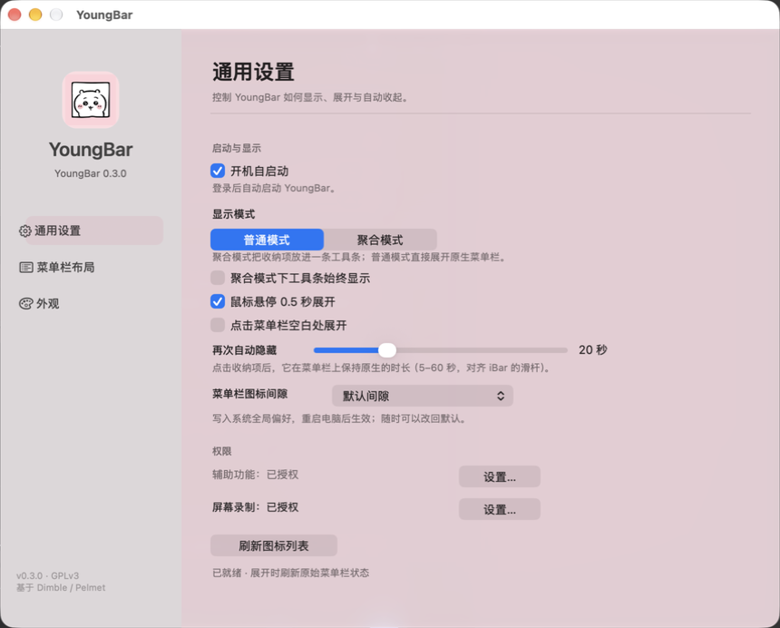

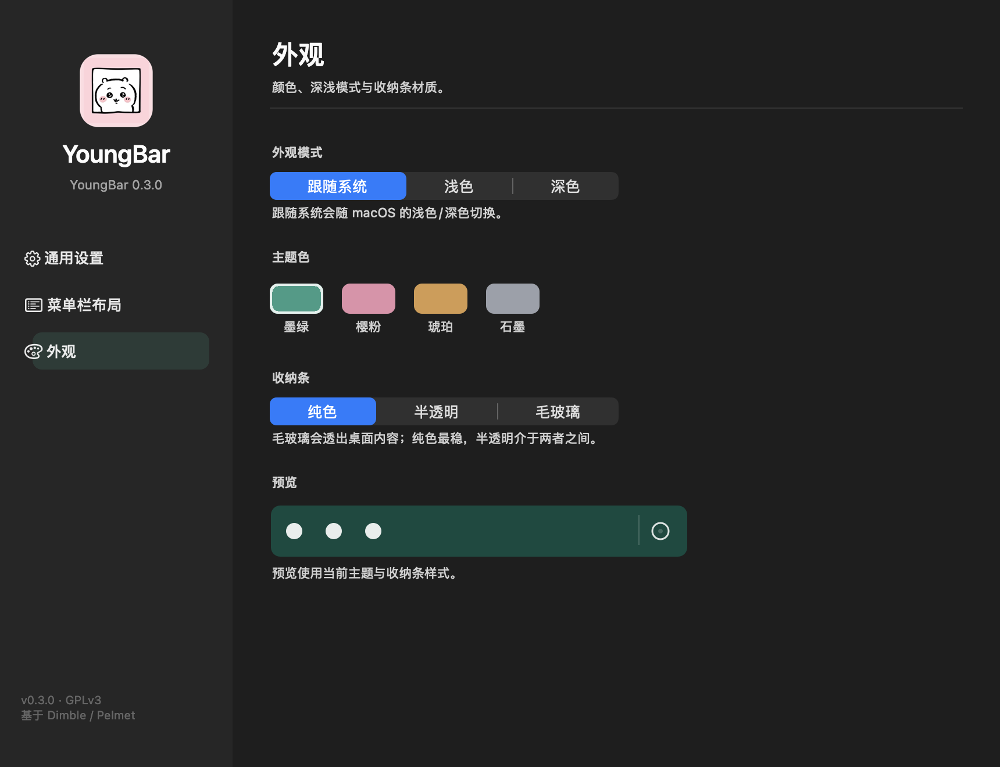

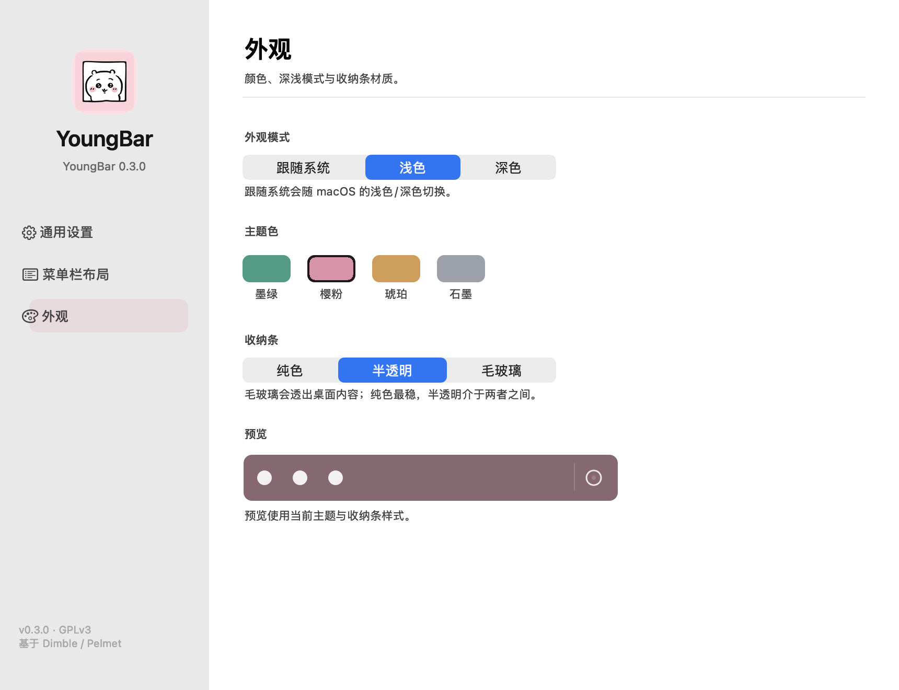

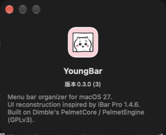

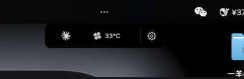

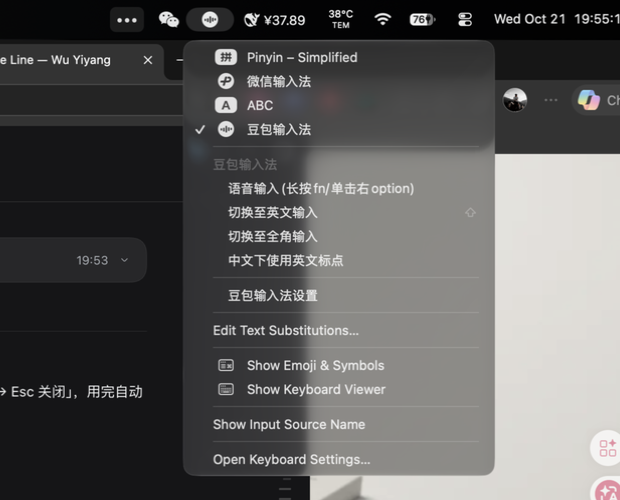

## 4.1 更正（2026-10-23）：设置窗口改为 SwiftUI

上面第 2 节里「设置窗口（860×660 / 860×692）」「统一窗口」「设置窗口玻璃」「卡片式布局」「一页布局」五行描述的是旧的 AppKit 设置窗口，**已被替换**，以本节为准。

| 项 | 状态 | 证据 |
|---|---|---|
| 设置窗口结构 | ✅ NSSplitViewController：侧栏（SwiftUI List）+ 内容（SwiftUI Form .grouped），默认 760×620，最小 740×480，记住窗口位置 | `docs/images/swiftui-*.png` |
| 三页 | ✅ 通用 / 菜单栏 / 外观，深浅色、中英文都能渲染 | `YOUNGBAR_SETTINGS_PREVIEW` 截图 |
| 侧栏选中 / 标题 | ✅ 选中高亮；窗口标题随页面变化 | 同上 |
| 切换语言 | 🟡 已实现：原地刷新，不再销毁重建窗口 | **未在真机点过** |
| 菜单栏页排序 | 🟡 已实现：拖动（`onMove`）+ 右键「左移 / 右移 / 最左 / 最右」，不能移到固定项右边 | **未在真机拖过** |
| 每项显示 / 隐藏 / 始终隐藏 | 🟡 已实现：每行一个弹出菜单，替代两个复选框 | **未在真机切换过** |
| 「点击 ••• 时」选项 | ✅ 修正了旧界面的标签反转：旧的「聚合模式」实际写入 `nativeExpand=1`（在菜单栏中展开），见 `main.swift` 的 `toggleShelf` | 代码 |
| 自检钩子 | 🟡 `refreshButtonScreenRect` / `loginHitTest` 改为读 SwiftUI 控件的位置 | **`YOUNGBAR_SETTINGSCLICKTEST` 未重跑** |

已知差距：侧栏还不是 macOS 27 System Settings 那种悬浮玻璃面板（`scrollContentBackground(.hidden)` 试过无效）；第一张卡片比系统设置靠下约 20pt（`contentMargins(.top, 0)` 试过无效）。

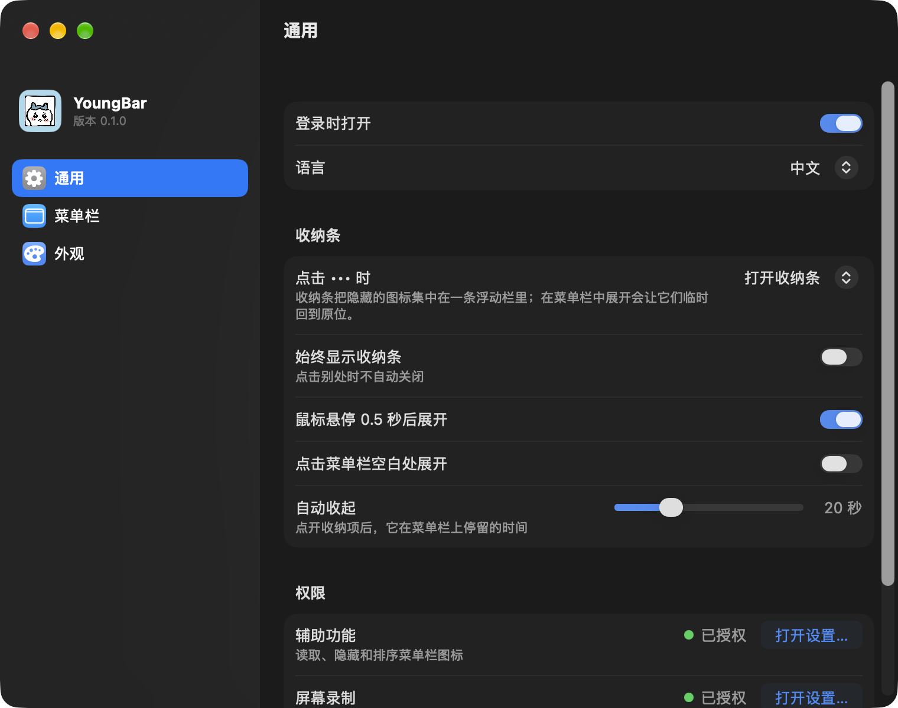

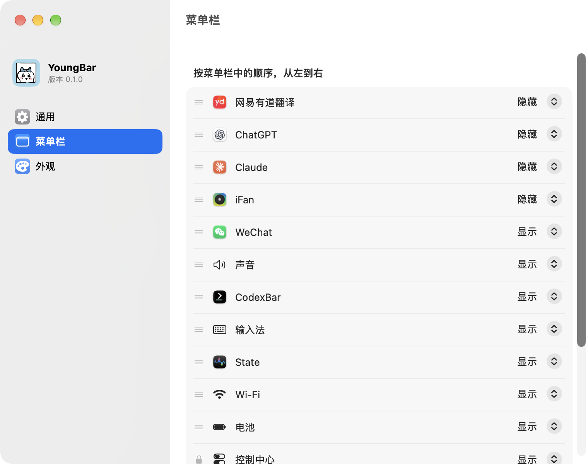

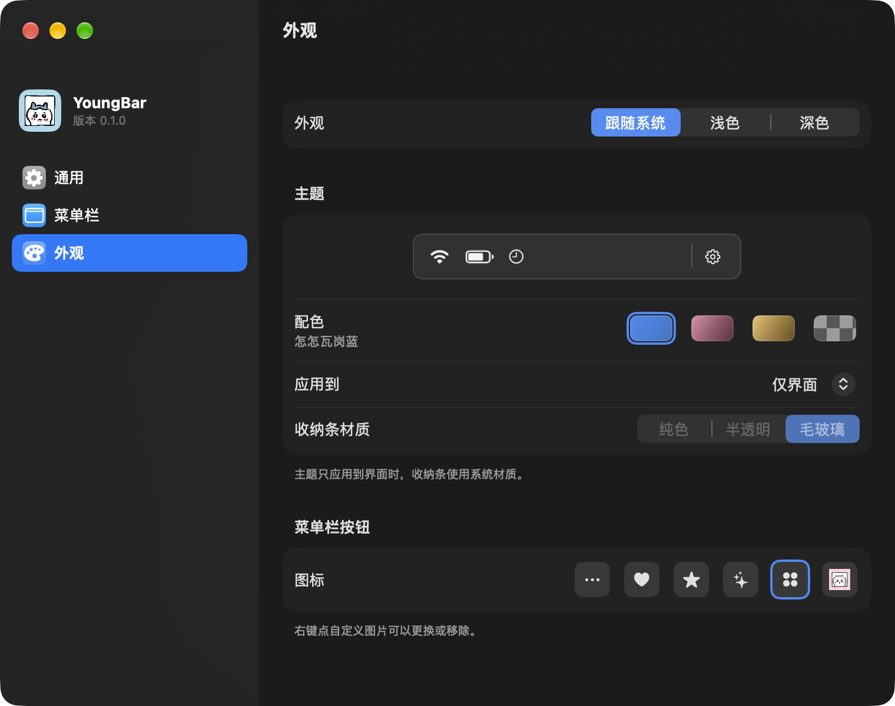

## 5. 下一步

1. 重启验证图标间隙四档；登出验证开机自启动。
2. 多显示器。
4. 在第二块显示器上重复布局与收纳。
