# YoungBar（羊霸霸）状态板

> 只写**当前**状态和它的证据。0.1.0 及之前的阶段记录（截图缓存、旧 AppKit 设置窗口等）
> 已原样移到 [`JOURNAL.md`](JOURNAL.md) 附录。
>
> 2026-11-05 改写过 Git 历史（去掉 Claude 尾注）：下面引用的短哈希是改写前的，对照表见 `JOURNAL.md` 同日条目。
>
> 最后核对：**2026-11-05 21:55 +00:00**，版本 **0.1.7 (8)**（已发布），MacBook 内建屏（1800×1169，刘海 790–1010pt），macOS 27。

## 1. 构建

| 项 | 值 | 证据 |
|---|---|---|
| 命令 | `sh Scripts/build.sh` → `build/YoungBar.app` | 构建通过（2026-10-29） |
| 工具链 | 只需命令行工具：Swift 6.4（CLT 27.0，2026-10-26 安装），**不需要 Xcode** | `swift --version`；包内不再使用 `@State`（宏插件只随 Xcode） |
| 测试版构建 | `TESTHOOKS=1 sh Scripts/build.sh`：编入 `TestHooks.swift` 的真机自检 | 正式版 `strings` 中 `YOUNGBAR_*TEST` 0 处；`otool -L` 无 ScreenCaptureKit |
| 单元测试 | `swift test --disable-sandbox`：89 项（事件日志、••• 位置检查、排序与落点、溢出判断、快捷键与保存值校验、配置文件、更新日志、收纳条内容、图片缩放、默认语言、菜单栏外观值） | 89 passed（2026-11-05，本机 macOS 27 和 CI 的 Linux、macOS）；70 passed（2026-11-04，Linux 与 CI 的 macOS），新增的 2 项还没在 Linux 上跑 |
| CI（0.1.5 起） | `.github/workflows/ci.yml`：Linux（swift:6.4-noble）跑单元测试；`xcode-27`（macOS 27.0.1、Xcode 27.1、Swift 6.4）跑单元测试、测试版编译（`-DYOUNGBAR_TESTHOOKS`）和 `Scripts/verify.sh`。`install-script.yml`：同一种机器上用 install.sh 装线上最新版、覆盖更新、拒绝 ad-hoc 包、证书比对拒绝别的签名 | Actions 日志里的 `sw_vers` / `swift --version`；见 2.4 |
| Linux 上的单元测试 | `Package.swift` 在 Linux 上只声明 YoungBarCore 和测试，`swift test` 可以在没有 Mac 的地方跑 | Docker `swift:6.4-noble` 与 CI：70 passed |
| 签名 | 本地 `YoungBar Local Signing` 证书；重建后辅助功能授权保持 | `codesign -dv`；重建后自检仍 `axTrusted:true` |

## 2. 当前行为与证据（0.1.1）

| 项 | 状态 | 证据 |
|---|---|---|
| 空闲 CPU | ✅ 0.32–0.33%（0.1.0：约 1.7%，40 小时累计 41 分钟） | 60 秒 `ps -o time` 差值，两次 |
| 刷新节奏 | ✅ 收纳条/设置打开或有定时展开时 1 秒；空闲 4 秒；应用启动退出、唤醒、显示器变化立即刷新 | `refreshInterval`、`startRefreshTriggers` |
| 飞行记录器（0.1.7） | ✅ `events.log` 分得清 ••• 是 YoungBar 自己移动还是外部移动，重启后保留上一轮；诊断报告带 ••• 的只读检查和最近 60 条事件。只在本机内建屏（单屏）上验证过，多屏和用户机器上还没有实际数据 | `flighttest.json` `passed:true`（2026-11-05） |
| 0.1.7 发布 | ✅ 公开仓库 `v0.1.7`（`4bbc940`）；线上 zip 校验和通过、满足 0.1.6 的证书要求；测试版假装 0.1.6 用应用内更新器真的装上线上 0.1.7，可执行文件和线上包哈希相同。没跑会操作鼠标键盘的自检（快捷键、拖动排序等） | `update.log`、`updatetest.json`（`offered:0.1.7`、`sigcheckAccepted:true`） |
| 快捷键打开收纳条 | ✅ 真实按键 ⌃⌥B 打开，收纳条成为键盘焦点，前台应用不变 | `keyboardtest.json`：`openedByShortcut`、`stripIsKey`、`frontAppStillFront` |
| 键盘导航 | ✅ 打开即选中第一项；→ 1、←← 绕回 4；Esc 先清搜索再关闭 | `selectionAfterOpen:0`、`selectionAfterRight:1`、`selectionAfterTwoLeft:4`、`queryClearedByEsc`、`closedByEsc` |
| 搜索 | ✅ 输入 "ifa" 只剩 iFan 且被选中；⌫ 删一字；无匹配显示「没有匹配的项目」 | `matches`、`searchFoundTarget`、`queryAfterDelete:"if"`、`noMatchCount:0`； |
| 自定义快捷键 | ✅ 改成 ⌃⌥⌘Y 后真实按键能打开、旧的 ⌃⌥B 失效；测试后恢复 ⌃⌥B | `openedByCustom`、`oldShortcutIgnored`、`restoredDisplay`；8 组组合各按一次均打开 1 次（`hotkeyprobe.json`） |
| 放不下的图标 | ✅ 把 5 个隐藏项临时全部显示：macOS 把有道收进 «，YoungBar 识别并列进收纳条；恢复后为空 | `overflowtest.json`：`overflowAllShown:[有道]`、`stripListsOverflow`、`restored`、`overflowAfter:[]` |
| 拥挤时的 ••• | ✅ 不再跟着被收进 « 的项跑到刘海下面；缩窄后停在 « 左侧 |  |
| 配置导入导出 | ✅ 导出 → 改一个选项 → 导入，模式、选项、顺序全部还原 | `configtest.json`：`passed:true` |
| 首次启动引导 | ✅ 新安装显示；老用户升级自动标记已看过；授权状态每秒刷新 | 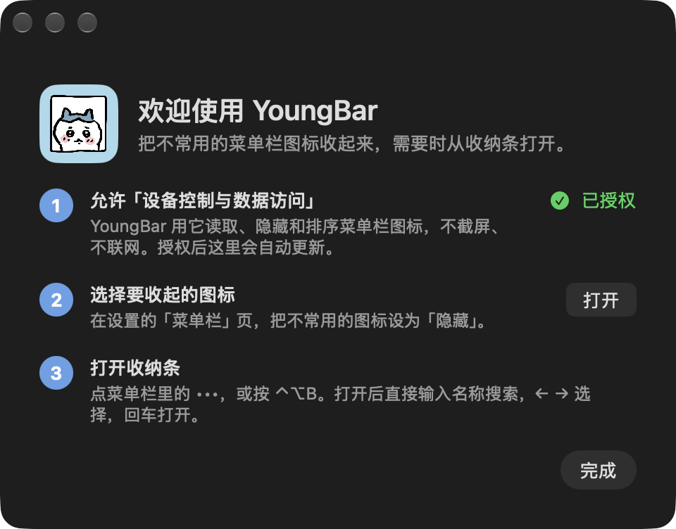 |
| 收纳条打开 | ✅ 21ms，不临时显示任何图标 | `shelfopen.json`：`openMs:21`、`revealedOnOpen:0` |
| 显示 → 自动收起 | ✅ | `selftest.json`：`appeared`、`autoHidden`、`goneAgain` |
| 测试后复原 | ✅ `itemModes`、`hiddenBundles` 与测试前备份相同；`barOptions` 只多了 `onboarded:1` | `defaults export` 前后对比 |

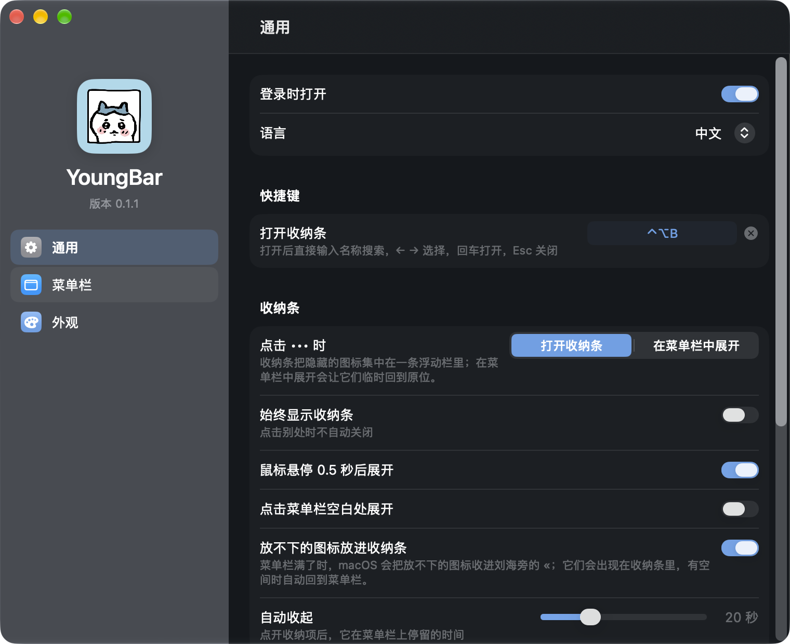

## 2.1 应用内更新（0.1.2，未发布）

| 项 | 状态 | 证据 |
|---|---|---|
| 已是最新 | ✅ 当前 0.1.1 对线上 0.1.1：显示「已是最新版本」 | `updatetest.json`：`state:upToDate` |
| 发现新版本 | ✅ 测试版假装 0.1.0：找到线上 0.1.1，显示更新说明 | `state:available`、`offered:0.1.1`；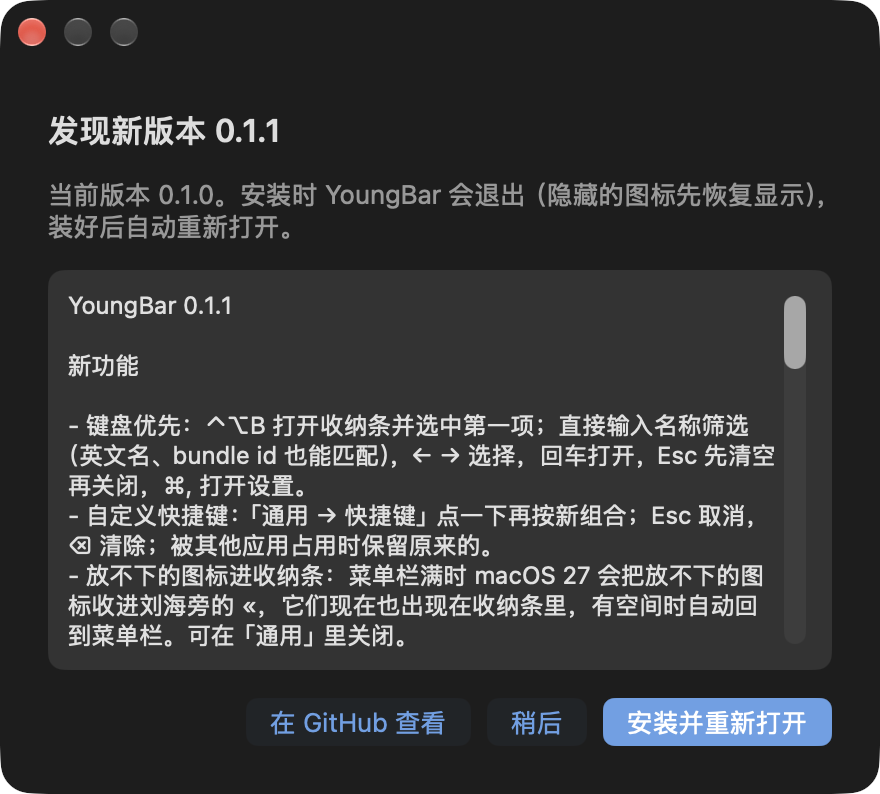 |
| 签名检查 | ✅ 本 app 通过；同一份 app 用 ad-hoc 重签后被拒 | `selfAccepted:true`、`sigcheckAccepted:false` |
| 端到端安装 | ✅ 下载 → SHA-256 → 解压 → 版本/签名检查 → 正常退出 → 脚本换 bundle → 重新打开；新进程 PID 不同，`build/YoungBar.app` 变成 GitHub 上的 0.1.1 发布包 | `update.log`：`installed 0.1.1 at …/build/YoungBar.app`；`strings` 无测试钩子 |
| 升级后权限 | ✅ 新版本照常隐藏图标（辅助功能授权保留） | 升级后菜单栏截图只剩常显项 |
| 更正 | 第一次端到端时卡在「正在安装」：在并发任务里直接调 `NSApp.terminate` 与 `applicationShouldTerminate` 的异步回复互相等待（`sample` 显示主线程停在 `-[NSApplication _shouldTerminate]` 的嵌套事件循环）。改为 run loop 上的 `perform` 后通过 | `sample` 输出；第二次 `update.log` |

## 2.2 用户反馈：多出一个 •••（2026-11-01，0.1.3）

小红书与交流群反馈「三个点和菜单栏图标重叠」「会多三个点 / 两个隐藏 logo」。

| 项 | 状态 | 证据 |
|---|---|---|
| 原因 | 控件是一块浮在菜单栏上的面板，下面垫着 YoungBar 自己的原生状态项（标题 `•••`）占位。有隐藏断言时 macOS 不绘制这个状态项；**没有要隐藏的项时**（新用户、隐藏的应用都没在运行）引擎撤掉断言，macOS 就把 `•••` 画出来，和浮动控件叠在一起 | `noassertiontest.json`：`assertionBare:false`，原生项 x 1037.5、控件 x 1035；（爱心控件旁露出原生 `•••` 的点） |
| 修复 | 原生状态项改为空白占位（无标题，保留 accessibility label），只由浮动控件画图标 | `nativeTitle:""`； 只剩一个控件 |
| 复现方式 | `YOUNGBAR_NOASSERTIONTEST=1`（可加 `YOUNGBAR_NOASSERTION_HOLD=秒`）：临时给引擎空模型，不改保存的模式，结束后恢复 | 两次运行均 `restored:true`，`concealedAfter` 与 `concealedBefore` 相同 |
| 单元测试 | 23 passed | `swift test --disable-sandbox` |

边界：本机控件图标是爱心；用户用的默认省略号没有单独截图，但原生项与控件位置的重叠关系相同。没有在拥挤（« 收走）的同时又无断言的状态下测过。

边界：只测了 `build/` 下、目录可写的情况；`/Applications` 里由非管理员用户运行（目录不可写）时会提示去 GitHub 手动下载，没有实测。下载中途取消没有实测。

## 2.3 0.1.4（2026-11-01 已发布）

> [Release v0.1.4](https://github.com/51younglowkey/youngbar/releases/tag/v0.1.4)：`YoungBar-0.1.4.zip` + `.sha256`（SHA-256 `7f6803b1…`）。端到端：测试版假装 0.1.3 → 找到 0.1.4 → 下载、校验、安装、重新打开（新 PID）；`build/YoungBar.app` 的可执行文件与发布包逐字节相同，无测试钩子，`YoungBar Local Signing` 签名；升级后菜单栏正常隐藏。证据：`updatetest.json`、`update.log`。

> 本节取代第 2 节里「快捷键打开收纳条」「搜索」「自定义快捷键」三行：默认快捷键已不是 ⌃⌥B，搜索已移除。

| 项 | 状态 | 证据 |
|---|---|---|
| 自动检查更新 | ✅ 启动 10 秒后、之后每天一次查 GitHub；假装 0.1.2 时找到 0.1.3：右键菜单第一行「有新版本 0.1.3，点此更新…」，控件提示文字也写明，**不弹窗、不自动安装**。始终开启，设置里没有开关。**更正**：第一版在 ••• 右上角加了圆点，用户要求去掉，只保留菜单行 | `autoupdatetest.json`：`found:0.1.3`、`menuTop`、`windowOpened:false` |
| 默认快捷键：连按两下 ⌘ | ✅ 真实按键连按两下 ⌘ 打开收纳条（键盘焦点在收纳条，前台应用不变）；⌘ 后接 ⌘⇧、两次间隔 0.7 秒都不触发；改成 ⌃⌥⌘Y 后能打开、⌘⌘ 失效；测试后恢复 | `keyboardtest.json`：`passed:true`、`defaultDisplay:"双击 ⌘"`、`commandShiftIgnored`、`slowTapsIgnored`、`doubleCommandIgnoredAfterChange`；另一个进程发出的 ⌘⌘ 也能打开（截图） |
| 设置里录快捷键 | 🟡 可以录组合键，或连按两下 ⌘ / ⌥ / ⌃；连按的识别逻辑有单元测试，**设置窗口里真的录一次没有实测** | `DoubleTapDetectorTests` 5 项 |
| 去掉搜索 | ✅ 收纳条里打字不再筛选；Esc 直接关闭 | `typingIgnored:true`、`closedByEsc:true` |
| 数字键 1–9 | ✅ 前 9 个图标标出数字；按数字直接打开（ChatGPT 菜单在收纳条旁弹出）；超过图标数的数字只响一声 | `digitPressed:true`（`digitTarget: codex`）、`digitPastEndIgnored:true`；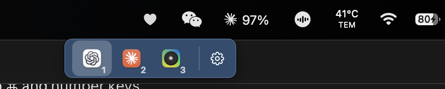 |
| 收纳条里拖动排序 | ✅ 真实鼠标把第一个拖到最后：收纳条和保存的顺序都跟着变，菜单栏没有任何图标被显示；测试后恢复顺序 | `shelfdragtest.json`：`stripReordered`、`savedOrderFollows`、`nothingRevealed`、`orderRestored` |
| 新图标自动收纳（默认关） | ✅ 打开选项后，把 State 当作新图标：自动设为隐藏并收进收纳条，提示「新图标已放进收纳条：State」；第一次运行（没有保存过顺序）不会触发；Apple 的图标不受影响；测试后恢复 | `autohidetest.json`：`modeAfter:1`、`concealed`、`inStrip`、`shownAgain`、`restored` |
| 更新内容窗口 | ✅ 从 0.1.3 升到 0.1.4 后第一次启动自动弹出；按「新增 / 优化 / 移除 / 修复」分区、每条一句短话，不含安装命令和校验；••• 菜单「本次更新内容…」可再打开；新安装不弹 | 真实启动截图；`extrastest.json`：`whatsNewShown`、`notesHaveNoInstall`；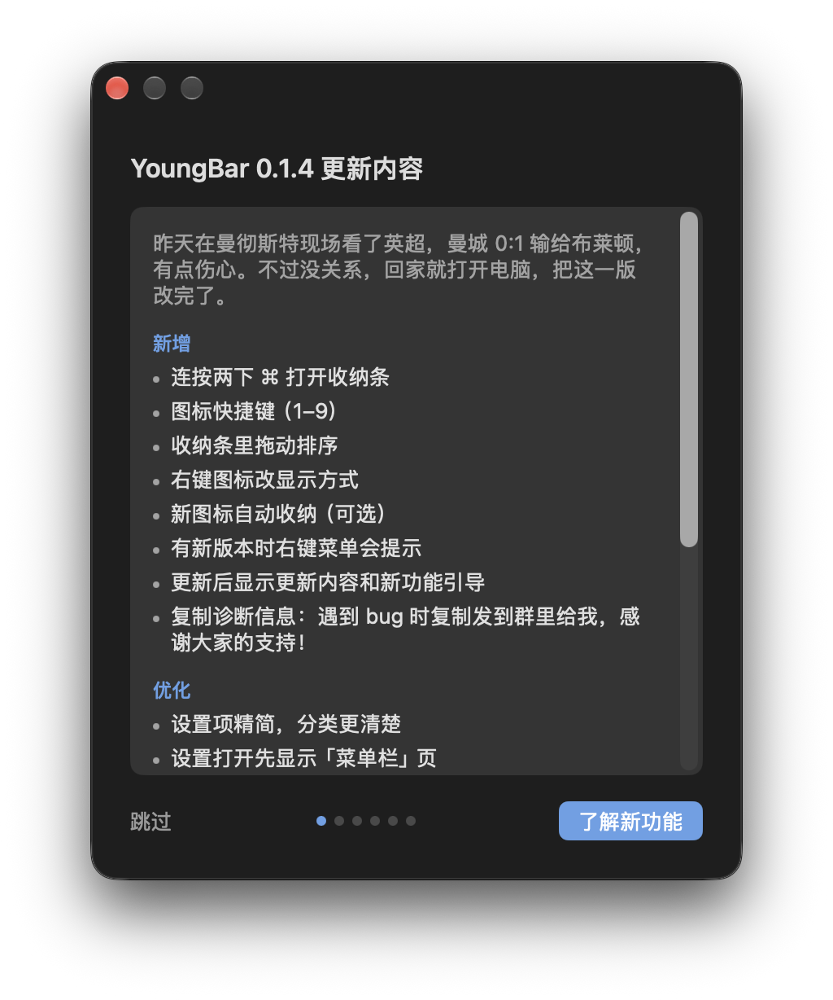 |
| 更新后先走引导 | ✅ 模拟从 0.1.3 升级（`lastLaunchedVersion=0.1.3` 后启动）：先弹出使用引导，授权那步显示「已授权」；点「完成」（Finder 在前台时一次真实点击就生效）后接着弹出更新内容。引导第 3 步改为「或连按两下 ⌘」 | 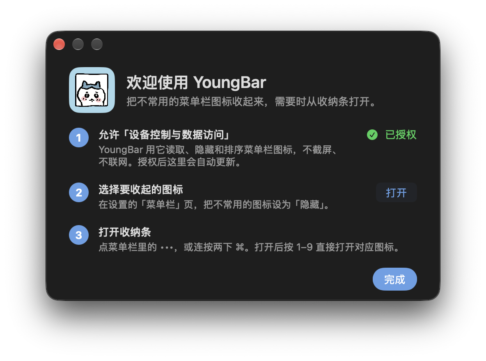 |
| 旧版更新窗口 | ✅ 中英分隔改为单独一行 `# English`：0.1.2/0.1.3 的更新窗口会把发布说明原样显示，隐藏注释会露出来，标题则显示为干净的「English」 | 单元测试 `picksTheReadersLanguage` |
| 新功能引导 | ✅ 更新内容页点「了解新功能」进入 5 页引导（连按两下 ⌘ / 数字键 / 拖动与右键 / 新图标自动收纳 / 更新提示与反馈），每页有跳过、上一步、下一步；第 1 页真的连按两下 ⌘ 后显示「成功打开了收纳条」；第 4 页的开关直接改设置 | `extrastest.json`：`tourSteps:5`、`tourSawShortcut:true`；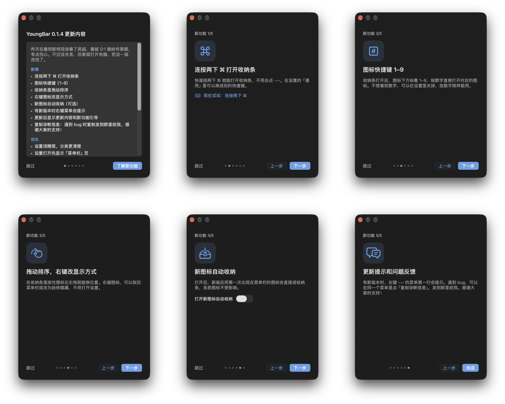 |
| 中英文 | ✅ 更新日志一个文件两段（单独一行 `# English` 分隔；不用隐藏注释，因为 0.1.2/0.1.3 的更新窗口会把它原样显示出来），更新内容和新功能引导跟随 **YoungBar 设置里的语言**，和前面的使用引导一致。**更正**：第一版跟随系统语言，本机系统首选 en-GB 而 YoungBar 设为中文，同一次更新里使用引导是中文、更新内容是英文，用户要求统一 | 本机（YoungBar 设为中文）更新内容显示中文；单元测试 `picksTheReadersLanguage`；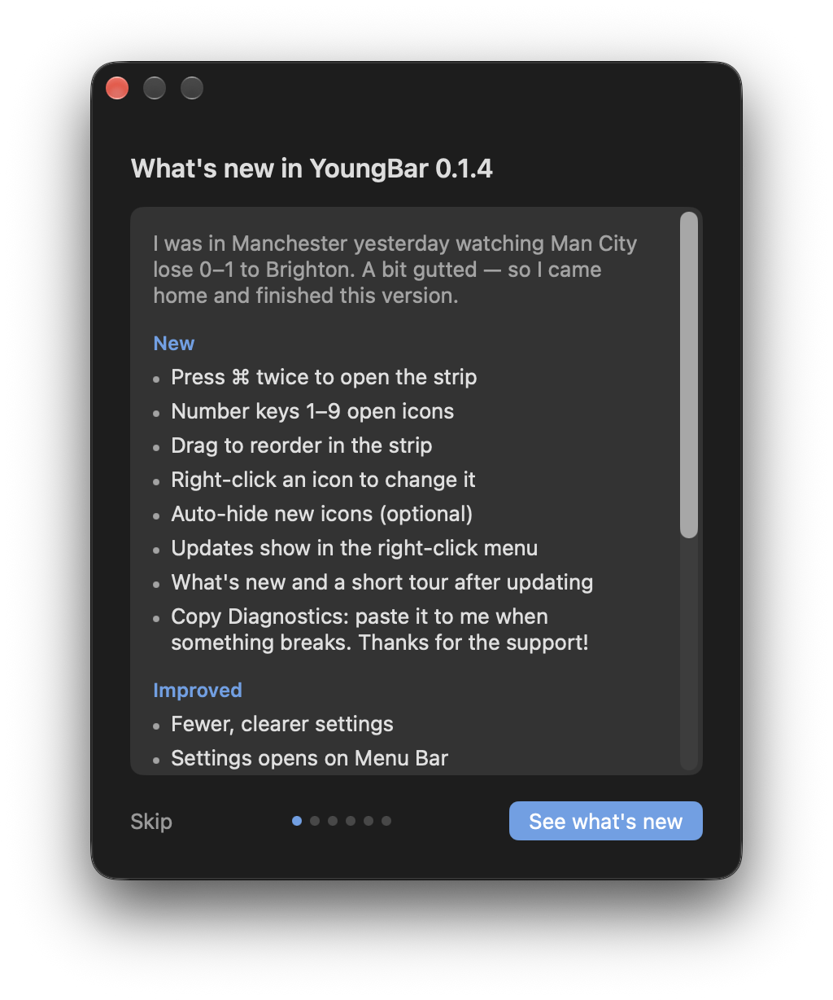 |
| 复制诊断信息 | ✅ ••• 菜单一项：复制 8 行纯文本（版本、macOS、机型、屏幕/刘海、权限与隐藏状态、快捷键、控件位置、各状态图标名单）并弹窗显示内容 | `extrastest.json`：`reportLines:8`、`report` |
| 收纳条图标右键 | ✅ 菜单列出另外两种状态和「在设置中调整…」；选「始终隐藏」后该图标离开收纳条；测试后恢复 | `menuTitles`、`modeAfterMenu:2`、`leftStrip`、`restored` |
| 数字显示开关 | ✅ 「图标下方显示数字」默认开，**点击 •••、悬停、快捷键打开都显示**；关掉后数字键照样能打开。**更正**：第一版只在快捷键打开时显示，用户点击打开看不到数字（用户报告） | `keyboardtest.json`：真实点击控件 `clickOpened`、`clickNumbersShown`、`clickStripIsKey`、真实 Esc `clickClosedByRealEsc`； |
| 设置精简 | ✅ 去掉：点击 ••• 方式（「在菜单栏中展开」会重影，已删除该模式）、始终显示收纳条、点击空白处展开、放不下的图标进收纳条（固定开）、自动收起秒数（固定 20 秒）、主题应用范围（固定全部）、右键菜单「左键显示菜单」、自动检查更新开关、刷新列表按钮；权限行只在未授权时显示。通用页分为：基本 / 收纳条 / 关于 | 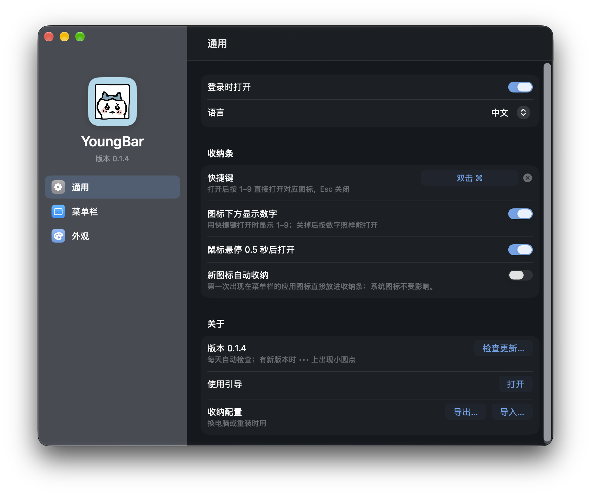 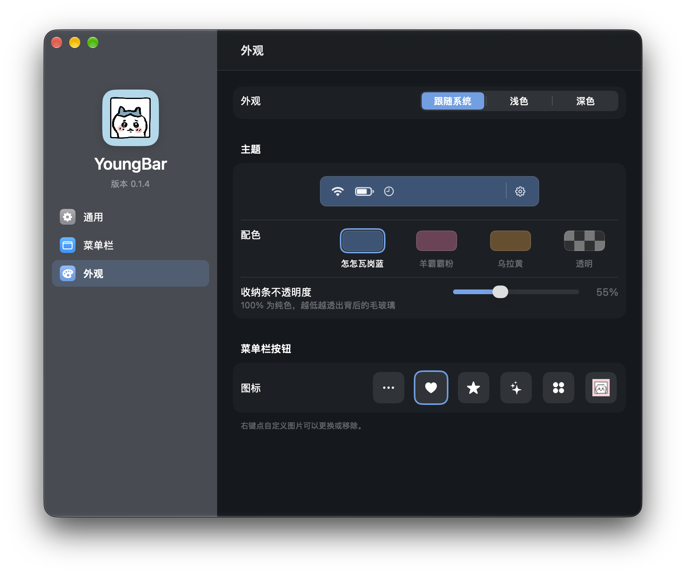 |
| 设置页顺序 | ✅ 侧栏改为 菜单栏 / 外观 / 通用；每次打开设置先显示菜单栏页（窗口已开着时只是拿到前台，不换页）；未授权时授权按钮在菜单栏页顶部。**未授权状态没有实测**（需要撤销权限） | 从收纳条齿轮真实点开：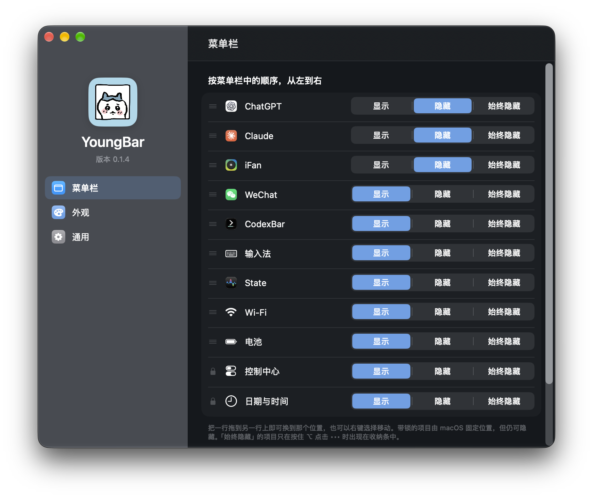 |
| 启动后 ••• 位置 | ✅ **修复**：刚启动时 ••• 被放在隐藏图标左边（x≈1099），图标约 2 秒后隐藏，但 ••• 要等下一次空闲刷新（约 6 秒）才移到旁边，这段时间点它原来的位置没反应。现在第一次隐藏后马上重新定位：约 2 秒就到位，启动 3 秒后点击能打开收纳条 | 每 0.5 秒记录控件窗口位置：修复前 6.1 秒到位，修复后 2.1 秒；启动 3 秒后真实点击截图 |
| 全面检查（2026-11-01 05:00–05:13） | ✅ 读完整个 0.1.4 差异后修了 5 处：① ⌘ 点击两次（Finder 多选、点链接）会被当成连按两下 ⌘ → 鼠标按下和滚动也会重置；② 授权前装好的监视器收不到按键 → 授权后第一次刷新重新注册；③ 开着「悬停打开」时，悬停打开后紧接着点击会把收纳条关掉（0.1.4 之前就有）→ 悬停打开后 1.5 秒内的点击不关；④ 忙的时候出现的新图标会漏掉自动收纳 → 先保存再排队应用；⑤ 删掉搜索留下的注释和无用变量。另外：载入时丢弃已废弃选项的旧值 | 下行自检 |
| 自检全套 | ✅ selftest、conceal、pinned、shelfopen、gear、about、hotkey（改为按当前快捷键）、keyboard（新增 ⌘ 点击不触发、真实点击打开）、extras、autohide、shelfdrag、noassertion、overflow、config、menu、order、hotkeyprobe、bulk、interaction、autoupdate、settingsui（真实鼠标）全部通过。**更正**：第一轮整批跑时 selftest / shelfopen / config / conceal 各失败过一次，单独重跑都通过：shelfopen 把前一个测试留下的 20 秒显示算了进去（已改为只算打开时新增的）；config 是旧选项键在导入后消失（已在载入时清理）；selftest、conceal 是前一个测试留下的显示项，未改代码。interaction 的 `concealedAfterTest:false` 是 0.5 秒时检查太早，随后截图确认已隐藏 | 各 `*.json`；`defaults export` 前后对比：图标模式与顺序一致，只多了 4 个显式的「显示（0）」和少了 3 个废弃选项键 |
| 单元测试 | 31 passed | `swift test --disable-sandbox` |
| 测试后复原 | ✅ 键盘测试前后 `defaults export` 只差 `sessionActive`（运行标记） | diff |

边界：老用户如果从没改过快捷键，升级后默认从 ⌃⌥B 变成连按两下 ⌘（改过的保留）。数字键之外的拖动只在 3 个图标、收纳条不滚动时测过。自动收纳只用「假装新图标」测过，没有真的装一个新应用。去掉的选项：老用户之前存的值会被忽略（例如开过「始终显示收纳条」的人升级后不再常开）。`YOUNGBAR_SETTINGSUITEST`（真实鼠标走设置窗口）本轮没有重跑。

## 2.4 0.1.5（2026-11-04 已发布）

> [Release v0.1.5](https://github.com/51younglowkey/youngbar/releases/tag/v0.1.5)：`YoungBar-0.1.5.zip` + `.sha256`（SHA-256 `5ea54fe852d925d94b5d916eb135067016f0e596d45a8e04c8f09d5b7dd64e38`），tag 指向 `e31b540`，`releases/latest` 指向它。签名 `Authority=YoungBar Local Signing`，满足 0.1.4 发布包的 designated requirement；`strings` 里没有 `*TEST`。端到端：测试版假装 0.1.4 → 找到 0.1.5 → 下载、校验、安装、重新打开（新 PID）；`build/YoungBar.app` 的可执行文件与发布包的 SHA-256 相同（`1d61ba04…`），没有测试钩子；`update.log` 记了这次安装；defaults 与备份无差异。公开仓库 [CI](https://github.com/51younglowkey/youngbar/actions/runs/41936556967) 和发布事件触发的 [安装检查](https://github.com/51younglowkey/youngbar/actions/runs/41936560897) 都通过（推 tag 触发的那次安装检查显示 cancelled，其余两次通过）。

> 下面先是云端开发时的记录，再是 Mac 上的两轮清单结果。

> 在云端 Linux 机器上做的：**跑不了 app，也没有你的 Mac**。证据只有两种：
> ① YoungBarCore 单元测试 **70 passed**（Linux 上 Docker `swift:6.4-noble`，和 CI 的 macOS 上都跑）；
> ② GitHub Actions `xcode-27`（macOS 27.0.1 / Xcode 27.1 / Swift 6.4）**编译通过**：调试版、测试版、正式版打包和 `Scripts/verify.sh`；同一种机器上 install.sh 装线上 0.1.4 通过（`install-script.yml`）。
> 下表的「状态」除了纯逻辑和安装脚本都是 🟡：代码与编译有证据，**真机行为没有证据**。发布前按表末的清单在 Mac 上跑一遍。
> 例外：「••• 掉到菜单栏下面」一行是之后在作者的 Mac 上测的，证据写在那一行。
> **更新（2026-11-04）**：清单已在作者的 Mac 上跑过，结果见表末「清单结果」，以那张表为准；下表的 🟡 是云端当时的状态，没有逐行改。

| 项 | 状态 | 证据 / 怎么验 |
|---|---|---|
| ••• 掉到菜单栏下面（小红书用户反馈，0.1.4） | ✅ 本机真机通过：安装时按菜单栏高度居中；每次刷新再按旁边第一个图标的竖直中心对齐（只在图标确实在这块屏的菜单栏里时）。**原因是推断**：用户机器上没拿到诊断，本机 0.1.4 没复现，所以用户那边是否解决要等反馈。只在本机测过（有刘海的内建屏、单屏、1800×1169、菜单栏 40 点、系统深色）；外接屏、多显示器、菜单栏自动隐藏、全屏、系统浅色都没测。之前的记录见 JOURNAL | 2026-11-04 移植到 ControlPanel.swift 后重跑。`YOUNGBAR_CONTROLYTEST=1`：`controlytest.json` 人为下移半个菜单栏（中心 19→39），一次刷新后回到 19，图标中心 19.5，`levelAfter:true`；菜单栏截图平齐。同一控件回归 `YOUNGBAR_APPEARANCETEST=1`：`appearancetest.json` `passed:true`、`controlIgnoresSetting:true`、`restored:true`，三步 `control == bar` 都是 dark，YoungBar 选浅色时 ••• 仍是 dark；菜单栏截图一致 |
| ••• 跟随菜单栏外观（Issue #4 的一黑一白） | 🟡 控件面板取 YoungBar 状态项按钮的外观（状态栏窗口），不再跟 YoungBar 自己的「外观」设置；每次刷新、切换深浅色、改外观设置时同步 | `YOUNGBAR_APPEARANCETEST=1`：`steps` 里每步 `control == bar`，`controlIgnoresSetting:true`；加 `YOUNGBAR_APPEARANCE_HOLD=3` 时每步 `screencapture -x -R <controlFrame>` |
| 收纳条为空时收图标进来 | 🟡 打开时一个都没有：上面一行说明，下面列出菜单栏上能收的图标（变暗带 ＋），点一下设为隐藏、收纳条不关，可以连续点；都收完或没有可收的时显示「去设置里选择」 | `YOUNGBAR_EMPTYSHELFTEST=1`：`adding`、`inStripAtOnce`、`concealed`、`stillOpen`、`restored`、`alphaAfterOpen:1`；单元测试 `ShelfContentsTests` |
| 设置里标「放不下」 | 🟡 被 « 收走或在刘海下的「显示」图标在菜单栏页标出 | `YOUNGBAR_OVERFLOWTEST=1` 新增 `settingsMarksOverflow:true` |
| 收纳条淡入 | 🟡 约 0.1 秒、手动四步（不依赖 `animator()`），减少动态效果时不淡入 | `YOUNGBAR_SHELFOPENTEST=1` 新增 `alphaAfterFade:1` |
| 新启动的应用（EngineSync） | 🟡 用 KVO 盯 `runningApplications`（只有菜单栏图标的应用不一定发启动通知），启动/退出时把运行中的应用告诉引擎并重新应用布局；设为「显示」（或第一次见）的应用有菜单栏图标却没出现（隐藏生效时 macOS 会把新注册停在屏幕外）就开一次接纳窗口（隐藏的图标闪一下）；设为「隐藏」的应用不在启动时开，等第一次从收纳条点它时再开；这次没等到图标的应用本次运行不再试。读取引擎事件，断言被撤或激活失败时重新应用（最多 10 秒一次；同一布局两分钟内三次仍不行就停，直到布局改变）。这些后台工作用 `syncing`，不挡点击和快捷键 | `YOUNGBAR_LAUNCHTEST=<一个菜单栏小工具的 bundle id>`：`holdsAssertion:true` 时 `onBarAfterLaunch` 与模式一致；隐藏一个图标后真的退出再打开一个带图标的应用，看图标是否回来、是否闪了一下 |
| 单独显示的图标都会收回 | 🟡 设置里排序后、点开收纳条图标 20 秒内改显示方式、导入配置、「全部显示」后「全部隐藏」——都改成配对的 `conceal(items:)` / `conceal(releasing:)` | `YOUNGBAR_SETTINGSUITEST=1`（排序）后把那个图标设为隐藏应能藏住；`YOUNGBAR_BULKTEST=1` |
| 「全部隐藏」 | 🟡 只藏应用图标（不藏 Wi-Fi、电池等）、藏起来的在收纳条里、不会被之后的重新应用悄悄撤销 | `YOUNGBAR_BULKTEST=1`；右键 ••• →「全部隐藏」后打开收纳条 |
| 导入配置的快捷键校验 | ✅（纯逻辑）不合法的快捷键数值不再导致导入和之后每次启动闪退；被占用时保留原快捷键；不导入/导出本机的图标间隙 | 单元测试 `SavedShortcutTests` |
| 收纳条与 ••• 的细节 | 🟡 •••不抢键盘焦点；悬停打开不接管键盘；被 « 收走的系统图标点了提示而不是点空；只塞到新弹出的窗口下面；原地打开后快速选菜单也会关；打开菜单时收纳条变宽不跳；重建保留滚动位置 | `YOUNGBAR_KEYBOARDTEST=1`、`YOUNGBAR_INTERACTIONTEST=1`、`YOUNGBAR_CONCEALTEST=1` |
| 设置细节 | 🟡 向右排序被拒也显示成功 → 改为按位置检查是否真的挨着目标（一个应用有几个图标时取离目标最近的那个）；忙时的点击不丢（同一行以最后一次为准）；中间有带锁项目时往右移不再变成往左；移除自定义图片不改动已选符号；菜单栏页显示操作结果；切语言清掉旧提示；「设备控制与数据访问」统一叫法 | `YOUNGBAR_SETTINGSUITEST=1`；单元测试 `MoveLandingTests` |
| 启动与更新流程 | 🟡 新安装跟随系统语言（老用户不变）；0.1.0/0.1.1 升级上来也走引导和更新内容；版本号在第一次刷新后才记下；新功能引导按准确版本匹配（0.1.5 三页）；登录项需要批准时提示并打开设置；自动检查失败一小时后重试 | 单元测试 `PreferredLanguageTests`；模拟升级：`defaults write studio.wuyiyang.youngbar lastLaunchedVersion 0.1.4` 后启动 |
| 更新器 | 🟡 不装比本机系统要求更新的版本；换包脚本保留旧版直到新版打开成功；等退出 10 分钟；下载中再点不重来；清理临时文件；package.sh 无证书时不打包 | `YOUNGBAR_UPDATETEST=1` + `YOUNGBAR_UPDATE_PRETEND_VERSION=0.1.4 YOUNGBAR_UPDATE_INSTALL=1`（发布 0.1.5 之后）；`make package` 在没有证书的环境应失败 |
| 安装脚本（install.sh） | ✅ 先解压、检查新 app，再动已安装的那份；ad-hoc 包不装；已安装的是作者签名时要求同一证书 | CI `install-script.yml`，macOS 27、从没见过作者证书的机器：全新安装线上 0.1.4 并启动、覆盖更新、ad-hoc 包被拒且已装的那份不动、ad-hoc 副本不满足已装那份的 designated requirement。退出正在运行的 YoungBar（AppleScript）那一段没测 |
| 安装脚本：系统低于 27 先退出 | ✅ 下载之前读 `sw_vers -productVersion`，主版本低于 27 或读不到时，用中英文说明「只支持 macOS 27 及以上（Apple 芯片）」后退出，不下载、不改动。真的旧系统没有试过（手头没有），macOS 27 上是用假的 `sw_vers` 扮演 26.3 | `install-script.yml` 在私有仓库 main 上（[run 7](https://github.com/51younglowkey/youngbar-dev/actions/runs/41928879110)，macOS 27 机器）：新脚本全新安装、覆盖更新线上 0.1.4 都通过；假装 26.3 时输出中英文提示、假的 `curl` 没被调用、已装那份可执行文件的 SHA-256 不变、YoungBar 仍在运行；ad-hoc 包和别的签名照旧被拒。2026-11-04 在 Linux 上用假的 `sw_vers` 和 `curl`，dash 与 bash --posix 各跑一遍：12.4、15.7.1、26.3、`abc`、没有 `sw_vers` 都在调用 curl 之前退出（退出码 1）；27.0、27.1、28.0 通过检查、走到 curl；按 README 的 `cat install.sh \| sh` 方式结果相同 |
| 自检本身 | 🟡 menutest / concealtest 收回显示的图标、恢复原模式；spacingtest 写回本机原值；临时模式只在内存里 | 跑完各自检后 `defaults export studio.wuyiyang.youngbar` 与之前对比 |
| 代码整理 | ✅ main.swift 1507 行拆成 main / ControlPanel / Shelf / LayoutActions / SettingsBridge / EngineSync；拆分时逐行核对没有丢行 | CI 编译通过 |

**没有处理（审查报告里提到，留给以后）**：
- 全屏空间里菜单栏隐藏时，••• 浮在应用上面（0.1.4 起就这样）。这一轮试过去掉 `.fullScreenAuxiliary`，复审指出那样全屏时就没有任何可点的地方（隐藏生效时 macOS 不画 YoungBar 自己的状态项），已撤回；要在真机上找到判断「全屏菜单栏是否滑下」的办法再做。菜单栏设为「自动隐藏」时同理。
- 收纳条拖动中途如果正好重建，这次拖动会丢；只保留了滚动位置。
- 换包失败只写在 `update.log`，下次启动不提示。
- `YOUNGBAR_DIAGNOSTICS=1` 时每次刷新逐项读 AX 位置（只影响开着诊断时的 CPU）。
- 自检收尾关窗口仍按「测试前屏幕上没有窗口」判断，不比较窗口号（gear / about 测试结束后现在会关掉自己打开的窗口）。
- 收纳条里调的顺序不会推到菜单栏上（这是现在的设计，注释已改正）。

**发布前在 Mac 上的清单**（`TESTHOOKS=1 sh Scripts/build.sh` 之后，每项单独 `open --env …=1 build/YoungBar.app`，结果在 `~/Library/Application Support/YoungBar/*.json`）：
1. `YOUNGBAR_APPEARANCETEST`（再在 YoungBar 里选深色、系统浅色时截一张菜单栏）
2. `YOUNGBAR_EMPTYSHELFTEST`
3. `YOUNGBAR_LAUNCHTEST=<菜单栏小工具 bundle id>`，以及手动：隐藏一个图标后退出并重新打开一个带菜单栏图标的应用
4. `YOUNGBAR_SHELFOPENTEST`、`YOUNGBAR_OVERFLOWTEST`、`YOUNGBAR_KEYBOARDTEST`、`YOUNGBAR_INTERACTIONTEST`、`YOUNGBAR_CONCEALTEST`、`YOUNGBAR_MENUTEST`、`YOUNGBAR_BULKTEST`、`YOUNGBAR_SETTINGSUITEST`
5. 全屏一个应用，鼠标移到顶部让菜单栏滑下，确认能点到 •••（已知：菜单栏收起时 ••• 浮在应用上）
6. 正式版 `sh Scripts/build.sh` 启动一次：先走使用引导，再是 0.1.5 的更新内容和三页新功能

**清单结果**（2026-11-04，main `0766a4e` 加两处自检修正；作者的 Mac：有刘海的内建屏、单屏、1800×1169、菜单栏 40 点、系统深色）。每项跑完比对保存的隐藏模式、顺序和选项，都和跑之前一致：

| 项 | 结果 | 证据 |
|---|---|---|
| `YOUNGBAR_APPEARANCETEST` | ✅ 系统深色通过。**系统浅色没测**（要改系统设置） | `appearancetest.json`：`passed:true`、`controlIgnoresSetting:true`、`restored:true` |
| `YOUNGBAR_EMPTYSHELFTEST` | ✅ | `emptyshelftest.json`：`passed:true`、`concealed:true`、`stillOpen:true`、`restored:true`、`alphaAfterOpen:1` |
| `YOUNGBAR_LAUNCHTEST=com.steipete.codexbar` | ✅ 只测了「显示」的应用。**隐藏时退出再打开、图标闪一下那条手动项没测** | `launchtest.json`：`passed:true`、`secondsUntilBack:1.29`、`mode:0` |
| `YOUNGBAR_SHELFOPENTEST` | ✅ | `shelfopen.json`：`passed:true`、`openMs:21`、`revealedOnOpen:0`、`alphaAfterFade:1` |
| `YOUNGBAR_OVERFLOWTEST` | ⚠️ **没测到**：全部显示时菜单栏也没挤满，`overflowAllShown` 是空的，`settingsMarksOverflow:true` 等于没判断。要在图标更多的时候重跑 | `overflowtest.json`：`restored:true` |
| `YOUNGBAR_KEYBOARDTEST` | ✅ | `keyboardtest.json`：`passed:true`、`frontAppStillFront:true`、`restoredDisplay` 回到默认 |
| `YOUNGBAR_INTERACTIONTEST` | ✅ 点开和收回通过。**清理不稳**：两次里有一次 Esc 和自检的清理都没关掉有道翻译的弹窗（`menuClosedAfterEscape:false`），手动把焦点切走后关闭。这是自检的收尾，不是产品路径 | `interactiontest.json`：`menuOpened:true`、`clickOpenedTargetUI:true`、`concealedAfterTest:true` |
| `YOUNGBAR_CONCEALTEST` | ⚠️ **结论不算数**：两次 `menuOpenRole` 都是 `AXWebArea`（探到的是下面的窗口），没有证明菜单真的开着；第二次 iFan 面板也没开（`fanWindowsAfterClick:0`）。这个自检用自己的点击，不走产品路径；产品路径的菜单由 `YOUNGBAR_MENUTEST` 证明 | `concealtest.json`，没有 `passed` 字段 |
| `YOUNGBAR_MENUTEST` | ✅ 输入法菜单真的打开又关上 | `menutest.json`：`passed:true`、`menuElementRole:AXMenuItem`、`menuClosed:true`、`restoredMode:true` |
| `YOUNGBAR_BULKTEST` | ✅ 第一次失败是自检过时：没有像 `restoreAppModes` 那样清掉 `bulkHiddenKeys`。改自检后通过，产品代码没动 | `bulktest.json`：`passed:true`，隐藏数 5→8→0→5，`modesUnchanged:true` |
| `YOUNGBAR_SETTINGSUITEST` | ✅ | `settingsuitest.json`：`modePassed`、`dragPassed`、`contextPassed`、`languagePassed`、`modesRestored`、`orderRestored`、`languageRestored`、`optionsUnchanged` 都是 true |
| 全屏时菜单栏滑下能点到 ••• | ⬜ **没测** | 第 5 项是手动项 |
| 正式版第一次启动（模拟从 0.1.4 升级） | ✅ 使用引导（授权显示已授权）→ 更新内容（有「••• 不再掉到菜单栏下面」，没有说明和校验）→ 新功能 1/3–3/3 → 正常结束，`lastLaunchedVersion` 记成 0.1.5。按钮是用辅助功能按的，不是鼠标点的 | 窗口截图、窗口文字 |

另外观察到：`engine.conceal(items:)` 之后 ••• 要等下一次刷新才靠回图标，中间有一段空白；约 8 秒后的截图已经归位。

**清单结果（第二轮，补上面没测到的）**（2026-11-04 晚，main `842b2c4` 加下面的修复；同一台 Mac）。每项跑完和 `defaults export` 的备份比对，都没有差异：

| 项 | 结果 | 证据 |
|---|---|---|
| 1. `YOUNGBAR_OVERFLOWTEST`（开 Stats、All、XApp 挤满） | ✅ 菜单栏出现 «，设置「菜单栏」页给有道和 Stats 标了「放不下」，两者都列进收纳条 | `overflowtest.json`：`crowded:true`、`passed:true`、`settingsMarksOverflow:true`、`stripListsOverflow:true`、`restored:true`；`overflowAllShown` 是有道、Stats；菜单栏和设置页截图 |
| 2. 隐藏的应用退出再打开 | ❌→✅ **第一次没过**：不在菜单栏，也不在收纳条和设置里（`inStripAfterLaunch:false`，设置里没有这一行）。修复后通过 | 修复后 `launchtest.json`（CodexBar）：`mode:1`、`holdsAssertion:true`、`onBarAfterLaunch:false`、`inStripAfterLaunch:true`、`inSettingsAfterLaunch:true`、`passed:true`；收纳条截图 |
| 2. 从收纳条点它 | ✅ 菜单开在收纳条旁边，收纳条不关，约 20 秒后图标收回。**和清单预期不同：其他隐藏图标没有闪**，日志没有 `adoptWindow`，这条路没用到接纳窗口 | 连拍 24 张；CodexBar 菜单窗口 310×1003、x=1350，收纳条 x=1242；图标从 `x=7` 到 `x=1362` |
| 3. 重开后、点它之前改成「显示」 | ✅ **疑似问题不成立**，代码没改：1 秒内回到菜单栏 | AX 位置 `x=7` → `x=1362`（按清单顺序走了两遍），菜单栏截图 |
| 4. 系统浅色 `YOUNGBAR_APPEARANCETEST` | ❌→✅ **第一次没过**：黑色桌面上在 YoungBar 里选浅色或深色时 ••• 变深色，几乎看不见。修复后黑色、浅色桌面都通过 | 修复前 `passed:false`、`controlIgnoresSetting:false`，连拍；修复后黑色桌面三步 `bar`/`control` 都是 dark、浅色桌面三步都是 light，含 YoungBar 选深色那步，`passed:true`、`restored:true`，连拍 |
| 5. 全屏时菜单栏滑下能点到 ••• | ✅ 作者本人操作，能打开收纳条 | 作者确认，没有截图 |
| 改完后的回归（系统深色） | ✅ | `appearancetest.json`、`controlytest.json`（`levelAfter:true`）、`launchtest.json`（显示的应用，0.85 秒回来）、`shelfopen.json`、`emptyshelftest.json` 都通过，defaults 无差异 |

这一轮的代码改动：`EngineSync.swift` + `main.swift`（`parkedKeys`：隐藏生效时重开的隐藏应用留在收纳条和设置里）；`ControlPanel.swift`（`menuBarAppearance` 只用状态项按钮的外观，不再退回系统设置）；`TestHooks.swift`（`YOUNGBAR_LAUNCHTEST` 要求找得到、新增 `YOUNGBAR_BARLOOKTEST`）；`RELEASE-0.1.5.md`。

发布步骤已在 2026-11-04 全部做完，结果见本节开头和上面的第二轮清单；步骤原文在提交 `e31b540` 的这个文件里。

## 2.5 0.1.6（2026-11-05 已发布）：••• 跟随当前桌面、更新后不再走引导

> [Release v0.1.6](https://github.com/51younglowkey/youngbar/releases/tag/v0.1.6)：`YoungBar-0.1.6.zip` + `.sha256`（SHA-256 `22fffc47b74003cc6aec2287acc93ea032c98d099632a7f65a2b334c551a3385`），tag 指向 `ab8d730`，`releases/latest` 指向它。线上下载的 zip 与测试过的那份逐字节相同。签名 `Authority=YoungBar Local Signing`，满足 0.1.1–0.1.5 发布包的 designated requirement；`strings` 里没有 `*TEST`。

| 发布后 | 结果 | 证据 |
|---|---|---|
| 端到端更新 | ✅ 测试版假装 0.1.5 → 找到 0.1.6 → 下载、校验、安装、重新打开（新 PID）；只弹「更新内容」 | `updatetest.json`：`offered:0.1.6`、`selfAccepted:true`；装好的可执行文件与发布包 SHA-256 相同（`5059cc89…`），没有测试钩子；`update.log` 记了这次安装。`Updater.swift` 与 0.1.5 没有差异，但真正的 0.1.5 二进制没有跑过这一遍 |
| 一键安装 | ✅ 发布事件触发的 `install-script.yml`：全新安装和覆盖更新都装的是 0.1.6；推 tag 触发的那次显示 cancelled，和 0.1.5 时一样 | Actions 日志 `Downloading YoungBar 0.1.6`、`YoungBar 0.1.6 is installed` |
| CI | ✅ 公开和私有仓库 `v0.1.6` 通过；公开仓库 main 那次写这条时还在跑 | Actions |
| 更新后弹什么 | ✅ 从 0.1.3、0.1.4、0.1.5 和没有版本记录的老版本启动 0.1.6，都只弹「更新内容」；同版本重启什么都不弹；全新安装只弹使用引导，关掉后不再弹别的。是在 0.1.6 上改 `lastLaunchedVersion` 模拟的，不是真的从老版本升上来 | AX 读窗口名；模拟后 defaults 与备份无差异 |
| 本机 | ✅ `build/YoungBar.app` 换成了发布包本身。defaults 与会话开始前的备份只差 `lastLaunchedVersion` 和 `loginItemToken`（都是版本号） | `diff`。登录项状态没有独立确认 |
| GitHub Contributors | ⏳ 按提交读的作者只有 `51younglowkey`；发布后侧栏仍列着 `claude` 和 `Youngbar`（缓存，见 `JOURNAL.md` 2026-11-05） | `contributors_list` 页面、GraphQL `authors` |

状态项按钮的外观启动后不变，所以 ••• 改问窗口服务器：`SLSGetMenuAppearanceThemeOnSpace` 按桌面返回菜单栏外观（0 浅、1 深）。不建状态项，不要屏幕录制，不读像素。过程见 `JOURNAL.md` 2026-11-05。

作者的 Mac：单屏、系统深色。桌面 5 黑、3 接近黑、8 和 6 海军蓝、4 灰蓝（都读到 1），7 浅色（读到 0）。下表的「一致」是 ••• 和微信图标相对菜单栏背景的明暗方向相同（自写脚本比对 `screencapture` 的连拍，读屏幕的是测试脚本，不是 app）。

| 项 | 结果 | 证据 |
|---|---|---|
| 修之前（基线） | ❌ 黑色桌面启动后切到浅色桌面，••• 仍是白的 | 脚本：浅色栏（亮度 222）上 ••• +29、微信 −189；`barlooktest.json` 切 10 次只有 1 条记录 |
| 从黑色 / 灰蓝 / 浅色桌面启动后来回切 | ✅ 切换约 1 秒后全部一致；明暗相反的桌面之间，切换动画里有一小段（不到 1 秒）••• 还是旧颜色（其他图标先变，`activeSpaceDidChangeNotification` 动画快结束才到） | 约 +1.1 s 和 +2.2 s 的连拍共 34 张，0 张不一致（约 +0.6 s 的 17 张有 9 张还在变）。`barlooktest.json` 三次都是 `passed:true`、`longestMismatch:0`，切 8 / 5 / 4 次，`spaceNotices` 次数相同。亮度：黑 ••• +228、微信 +229；海军蓝 +205、+206；灰蓝 +128、+129；浅色 −188、−189。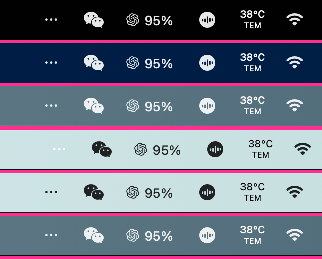 |
| 正式版（不带测试钩子） | ✅ 同样来回切，一致 | 9 张连拍 0 张不一致；`strings` 里自检开关 0 处，`otool -L` 无 ScreenCaptureKit |
| 全屏空间 | ✅ 浅色桌面上全屏一个应用：读到 1，白色 ••• 落在刘海屏全屏的黑带上；退出后变回深色 | `barlooktest.json`：`space=1570 theme=1`，退出后 `space=7 theme=0`；截图 ••• +229 |
| 启动核对 | ✅ 按钮和窗口服务器对不上时不信接口；对得上时信 | 从浅色桌面启动、停在黑色桌面时跑一次：`launchCheckAtEnd {button:light, theme:dark, trusts:false}`；从黑色和灰蓝启动、结束时一致：`trusts:true`。三个桌面启动后都是 `distrusted:false` |
| 不信接口时的回退 | ✅ ••• 跟按钮（和 0.1.5 一样不跟桌面），恢复信任后下一次同步就对了 | `YOUNGBAR_BARLOOK_DISTRUST=1`：`control=dark`、`space=7 theme=0`，浅色栏上 ••• +29；之后截图 −188 |
| 不影响引擎 | ✅ 没有新建或重建状态项，切桌面不换断言，隐藏的图标不出来 | `dimble.log` 同一段：切 12 次，13 条 `converge: no-op`，0 条 `swapping`；`concealedCount` 一直是 5、`itemCount` 一直是 12 |
| 回归 | ✅ `YOUNGBAR_APPEARANCETEST`、`YOUNGBAR_CONTROLYTEST`（黑、灰蓝、浅色桌面各一次）；`swift test` | `passed:true`、`controlIgnoresSetting:true`、`restored:true`、`levelAfter:true`；72 passed |
| 测完复原 | ✅ 重新打开主目录的 app，`defaults export` 和跑之前的备份没有差异 | `diff` 无输出，SHA-256 相同 |
| 开销 | ✅ 读一次约 37 微秒，只在切桌面和每次刷新时读 | 2000 次取平均 |
| 发布前自检（0.1.6） | ✅ `YOUNGBAR_SELFTEST`、`YOUNGBAR_SHELFOPENTEST`、`YOUNGBAR_CONFIGTEST`、`YOUNGBAR_KEYBOARDTEST`；⚠️ `YOUNGBAR_OVERFLOWTEST` 没有结论（`crowded:false`，这轮代码没动）；❌→✅ `YOUNGBAR_KEYBOARDTEST` 第一次没过（连按两下 ⌘ 没打开），当时有人在操作这台 Mac（最前面的应用变了，判断是干扰，属推断），重跑通过 | 各 JSON 的 `passed:true`；`overflowtest.json` 的 `inconclusive`、`restored:true`；跑完 defaults 和跑之前没有差异 |
| 系统浅色 | ⬜ 作者决定跳过，0.1.6 发布时没测 | 见第 3 节、第 4 节第 1 条 |

## 2.6 用户反馈：♥ 和空白占位分开（2026-11-09，未发布）

小红书反馈（M5 Air，macOS 27.0.1）：菜单栏上 ♥（控件）和一块空白隔着一个别的图标；点 ♥ 和点空白都打开收纳条，空白处有时显示三个点。

| 项 | 状态 | 证据 |
|---|---|---|
| 原因（推断） | ••• 一直跟在「最左边的可见图标」左侧，默认 YoungBar 自己的状态项就在那里。macOS 画出这个空白占位、而它左边又有别的图标时（之后启动的应用会插到左边），两者就分开：••• 在那个图标左边，占位在右边，点它照样打开收纳条。本机隐藏生效时自己的项没有位置（快照里没有 frame），所以一直没出现；11-06 的无断言自检其实已经录到分开（控件 x1010、自己的项 x1070.5），当时没检查 | `noassertiontest.json`（11-06）；`events.log` 恢复后的图标列表里没有 YoungBar |
| 修复 | `ControlPlacement`（YoungBarCore）：自己的项在菜单栏上、左边有别的图标、又没被图标盖住时，••• 盖在它上面；否则照旧跟最左边的图标。诊断里「贴着图标」按同一规则算 | 单元测试 96 passed（新增 7 项） |
| 本机 | 隐藏生效时位置不变（x1155，跟 Stats x1195） | `events.log` |
| 没验证 | 用户那种情况本机没复现：无断言自检时 7 个隐藏应用同时显示，菜单栏挤满，••• 走了 « 那一支（`controlBare` w22）。「空白处显示三个点」的来源没查清 | `noassertiontest.json`（11-09） |

## 3. 验证边界（不许含糊）

- ••• 跟随桌面只在**系统深色**、内建屏上测过。没有测（要改系统设置或要第二块屏）：系统浅色配深色壁纸、同一桌面换壁纸、系统切深浅色的那一刻、「减少透明度」和菜单栏背景设置、第二块屏。这些情况下如果启动时接口和按钮对不上，会回退到按钮；启动之后才出现的不一致，要等重启才会发现。
- **多显示器没有验证**（手头只有内建屏）。已做的只是代码层面：显示器增减时把控件放回状态项旁；
  空白处点击、溢出判断只看控件所在那块屏；兜底位置用主屏而不是「当前有键盘焦点的屏」。
- 溢出只在「把隐藏项全部显示」这一种拥挤方式下实测过一次；被 « 收走的是有道。
  « 菜单里的项从收纳条点开时走 AXPress，没有单独真机点过。
- 键盘测试中收纳条里的按键是直接送给处理函数的（不是真实键盘事件），只有快捷键本身是真实按键。
  第一次跑自定义快捷键时 ⌃⌥⌘Y 有一次没打开，之后 3 轮共 10 次都正常；推测是测试期间有真实鼠标点击把收纳条关了，未确认。
- 系统级快捷键（如输入法切换）会抢在 YoungBar 之前，注册时 macOS 不报冲突，所以这种冲突检测不到。
- 设置测试（`YOUNGBAR_SETTINGSUITEST`，真实鼠标）本轮没有重跑：它会接管鼠标。
- 图标间隙需要重启才能看到效果；开机自启动没有真的登出再登录过。
- 一次重启后，两个隐藏项（Figma、iFan）的保存顺序按 macOS 的实际顺序校准了，与测试前备份不同；这是既有的「顺序跟随真实菜单栏」行为。

## 4. 下一步

1. 作者把系统切到浅色，用 `YOUNGBAR_BARLOOKTEST` 切一轮桌面（包括深色壁纸和全屏空间）：••• 跟随桌面还没在系统浅色下测过（见第 3 节）。
2. 过一两天再看 GitHub Contributors 侧栏；`claude` 或 `Youngbar` 还在就由作者找 GitHub Support 清除。
3. 有第二块显示器时验证：控件、收纳条位置、点开隐藏项、••• 跟的是它所在那块屏的桌面。
4. 从收纳条点开被 « 收走的项。
5. 重启验证图标间隙；登出验证开机自启动。
